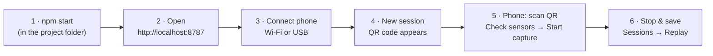
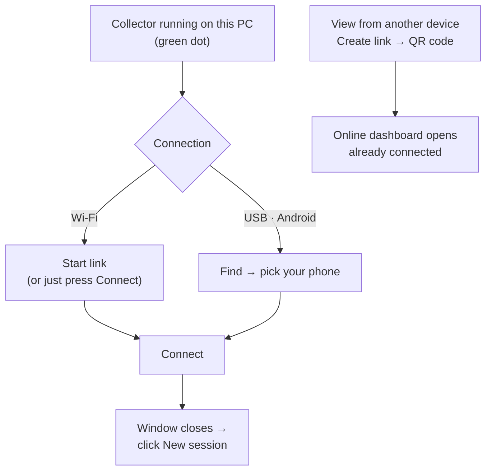
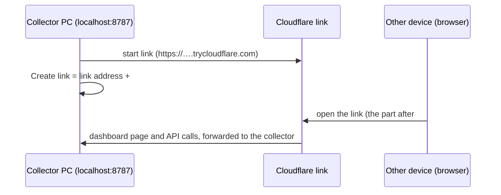
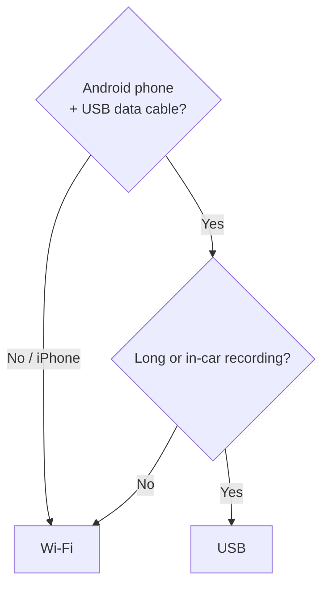
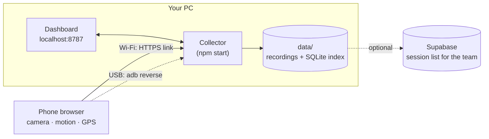
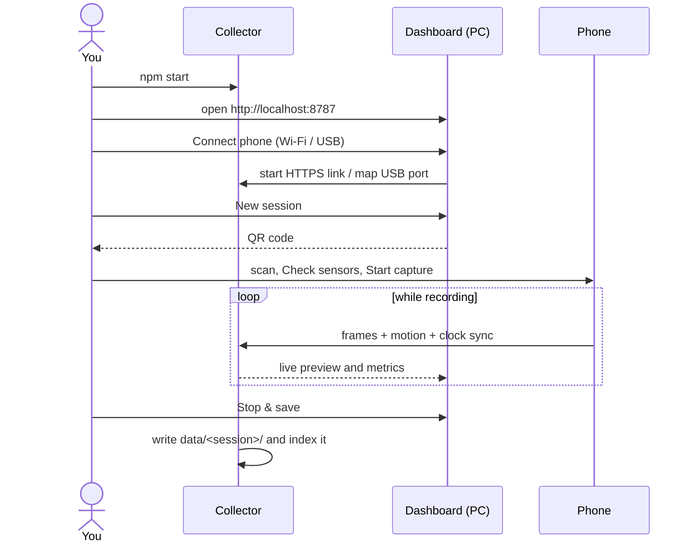

# How to use Tepegoz

Record your phone's camera and motion sensors on your PC, then replay and analyse them.

**You do not need a token, an account, or any configuration.** One program runs on your PC,
and you use it from your PC's browser.

---

## 1. One-time setup

| What | Why | How |
|---|---|---|
| Node.js 22.13 or newer | runs the collector | [nodejs.org](https://nodejs.org) (LTS) |
| The project | | `git clone https://github.com/DeoneAI/tepegoz.git` |
| **For Wi-Fi:** cloudflared | gives the phone a secure (HTTPS) link | `winget install --id Cloudflare.cloudflared` |
| **For USB (Android):** Platform-Tools | lets the cable carry the connection | [Android Platform-Tools](https://developer.android.com/tools/releases/platform-tools), then turn on **USB debugging** on the phone |

You only need cloudflared **or** Platform-Tools, depending on how the phone will connect.

---

## 2. Every time you record



1. **Start the collector.** In the project folder:
   ```bash
   npm start
   ```
   On Windows PowerShell, use `npm.cmd start` if `npm start` is blocked.
2. **Open the dashboard** on the same PC: **http://localhost:8787**. It connects by itself; the top bar shows *Collector online*.
3. **Connect phone** (top-right). Choose **Wi-Fi** or **USB · Android**, then **Connect** (every option is explained in section 3).
4. **New session.** Give it a name. A QR code appears in the *Phone* panel.
5. **On the phone:** scan the QR code with the camera, tap **Check sensors**, then **Start capture**. Keep the page open and the screen on.
6. When done: **Stop capture** on the phone, then **Stop & save** on the PC. Open **Sessions → Replay** to watch it.

---

## 3. The "Connect phone" window

Open it with **Connect phone** (top-right of the dashboard). It has four parts, from top to bottom.



**① Status line: "Collector running on this PC"**
A green dot means the dashboard can talk to the collector, and nothing needs to be typed. If the
line is missing, the collector is not running: start it with `npm start` and reopen the window.

**② Connection: Wi-Fi or USB · Android**
Pick how the phone will reach this PC (see section 4 if unsure). The area below changes with your choice.

*If you picked Wi-Fi:*

| You see | Meaning | What to do |
|---|---|---|
| **Not started** | No HTTPS link yet | Press **Start link**, or just press **Connect**: it starts the link for you. |
| **Starting…** | cloudflared is creating the link (usually 5–15 s) | Wait. |
| **Running · xxxx.trycloudflare.com** | The phone can now reach this PC from any network | Press **Connect**. |
| **cloudflared is not installed** | The Wi-Fi option needs it once | Run `winget install --id Cloudflare.cloudflared`, then press **Start link** again. |
| **did not report an address within 30 s** | No internet connection on the PC, or a firewall blocks cloudflared | Check the PC's internet, then try again. |

*If you picked USB · Android:*

1. Plug the phone in with a **data** cable and unlock it.
2. On the phone, turn on **Developer options → USB debugging** (once).
3. Press **Find**. When the phone asks *Allow USB debugging?*, tap **Allow**, then press **Find** again.
4. Pick your phone in the list and press **Connect**.

| You see | What to do |
|---|---|
| **Phone found.** | Pick it and press **Connect**. |
| **No phone found…** | Use a data cable (not charge-only), unlock the phone, accept the debugging prompt, press **Find** again. |
| **ADB not found…** | Install Android Platform-Tools (section 1). |
| a phone listed as *unauthorized* | Unlock the phone and tap **Allow** on the USB-debugging prompt. |

**③ View from another device (one click).**
Watch this collector from a laptop or phone anywhere. The dashboard is served by the collector itself,
through its secure Cloudflare link:

1. Press **Create link**. The collector starts its secure Cloudflare link if it is not running yet.
2. Scan the QR code with the other device, or press **Copy link** / **Open**.
3. The dashboard opens on that device already signed in. You never copy an address or a token by hand.



Keep the link private: anyone with it can control the collector. It stops working when the collector
restarts (the address changes); press **Create link** again.

*Manual fallback* (on the online dashboard under **Enter address and token manually**): the address is
the *Running · …trycloudflare.com* line in this dialog; the token is printed by `npm run token`.

**④ Cancel / Connect**
**Connect** saves your choice and closes the window. The *Phone* panel then shows **Wi-Fi** or
**USB**. Next, click **New session**: its QR code is what the phone scans. Errors appear in red
above the buttons; nothing is changed until **Connect** succeeds.

---

## 4. Wi-Fi or USB?



| | Wi-Fi | USB |
|---|---|---|
| Phones | Android and iPhone | Android |
| Networks | any (home Wi-Fi, mobile data) | the cable |
| Stability | good | best |
| Needs | cloudflared on the PC | Platform-Tools on the PC, USB debugging on the phone |

**Why Wi-Fi needs a "link":** phone browsers only allow the camera and motion sensors on secure
(HTTPS) pages. When you choose Wi-Fi, the collector creates a temporary HTTPS address for your PC
(a free Cloudflare quick tunnel). The link changes each time the collector restarts, so create a new
session after a restart. USB doesn't need this because the phone reaches the PC at its own
`localhost`, which browsers treat as secure.

---

## 5. How it fits together





---

## 6. Where is my data?

Everything stays **on your PC**:

```
data/
├── sessions.sqlite          index of all sessions (fast library, survives restarts)
└── <session-id>/
    ├── manifest.json        name, device, status, metrics
    ├── frames/00000000.jpg  camera frames
    ├── frames.csv / .jsonl  per-frame timestamps
    ├── imu.csv              accelerometer + gyroscope
    ├── gnss.csv             GPS (if enabled)
    ├── telemetry.jsonl      all samples as received
    └── clock.jsonl          phone↔PC clock estimates
```

If the dashboard says **Collector offline**, nothing is lost. The collector simply isn't running;
start it with `npm start`.

---

## 7. Optional extras

**Share the session list with your team (Supabase, free).** Only metadata is uploaded; frames stay on the PC.

1. Create a project at supabase.com and run the SQL from [docs/CONNECTING.md](docs/CONNECTING.md#optional-share-the-session-list-with-supabase-free-tier).
2. Copy `.env.example` to `.env` and fill in `SUPABASE_URL` and `SUPABASE_SERVICE_ROLE_KEY`.
3. `npm start`. The terminal shows `SQLite + Supabase mirror`.

**No PC running? Use the cloud collector.** Deploy the same collector to Render's free plan and the phone connects straight to it: see [docs/RENDER.md](docs/RENDER.md).

**Open the dashboard from another device.** On the PC: **Connect phone → View from another device →
Create link**, then scan the QR code (section 3, part ③). `npm run token` is only needed for the manual
fallback.

---

## 8. Troubleshooting

| Problem | Fix |
|---|---|
| *Collector offline* | Run `npm start` and keep that terminal open. |
| *cloudflared is not installed* | `winget install --id Cloudflare.cloudflared`, then try again. |
| *No phone found* (USB) | Data cable (not charge-only), unlock the phone, accept *Allow USB debugging*. |
| Phone page says HTTPS is required | You opened the link without the Wi-Fi link or USB mapping. Connect phone first, then create a new session. |
| Gyroscope "unavailable" | Allow *Motion sensors* in the browser's site settings, or try Chrome. Missing sensors are never faked. |
| QR code no longer works | The Wi-Fi link changes when the collector restarts. Create a new session. |
| Frames stop when the phone screen locks | Keep the capture page visible and the screen on. |

Research use only. Record road-facing video only as a passenger.
