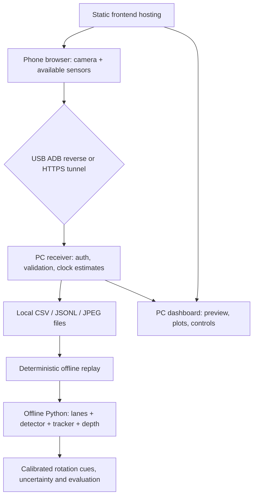
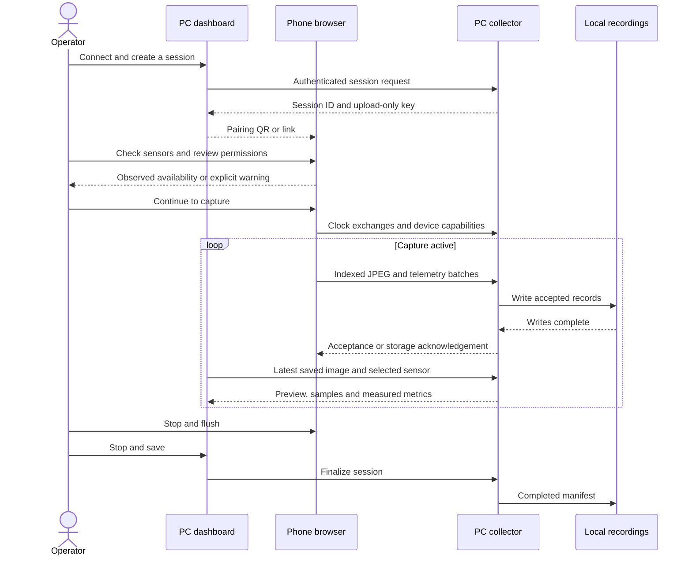
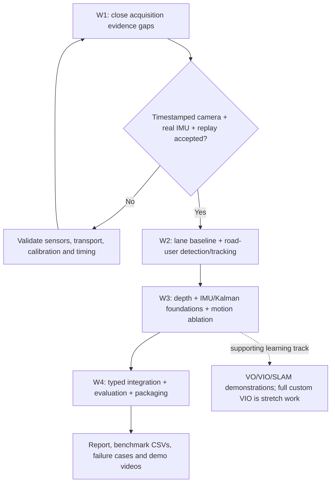

# Tepegoz

**Continuing on a coworker's PC? Start with the [Weeks 1–3 handoff](docs/handoff/START-HERE.md)** for fresh installation, the team's existing Vercel project, week-by-week tasks and evidence to collect.

**Smartphone-to-PC acquisition and recorded road perception with depth and motion experiments.**

Tepegoz contains the **Sensorlink acquisition prototype** plus offline PC lanes, road-user detection/tracking, depth, Kalman exercises, gyro orientation and visual-inertial experiments. The project follows the supplied [one-month assignment and technical addendum](docs/roadmap/assignment.pdf).

**Development frontend:** [tepegoz-tawny.vercel.app](https://tepegoz-tawny.vercel.app). The coworker handoff uses the team's existing Vercel project instead; no account migration is required. Network capture uses an HTTPS tunnel to the running PC collector; recordings and offline analysis stay on the PC. USB setup uses the local dashboard at `http://localhost:8787`.

**Current milestone: Weeks 2–3 implemented and evaluated with public datasets; Week 1 physical acceptance remains partial.** No new phone recording is available. Public data exercises the PC pipeline without establishing phone/USB performance. The local estimator is an attitude-only experiment, not full VIO/SLAM. Android Camera2 and SensorManager remain acquisition alternatives to the current browser client.

[Getting started](BASLA.md) · [Progress tracker](docs/STATUS.md) · [20-day checklist](docs/ROADMAP.md) · [Perception and estimation](docs/PERCEPTION-AND-ESTIMATION.md) · [Measured results](docs/reports/WEEKS-2-3.md) · [Validation](docs/VALIDATION.md)

## What works today

- Rear-camera access through `getUserMedia()`, timestamped JPEG uploads and latest-saved-frame preview.
- Accelerometer and available gyroscope/GNSS telemetry, sensor preflight, live inertial plots, per-sensor measured rates and loss diagnostics.
- HTTPS-tunnel pairing and Android USB/ADB reverse support in the receiver and dashboard.
- Upload-only phone keys, separate collector admin authentication and exact-origin checks.
- CSV/JSONL/JPEG recording, clock-offset estimates, stop/finalization, replay and optional offline Parquet export.
- A dependency-free Node runtime and static frontend; Vercel hosts the frontend, while the PC stores recordings.
- Python/ONNX classical and pretrained lanes, six road-user classes, temporal tracks, relative and learned metric-depth alternatives, independent indexed logs and overlay videos.
- Reproducible CPU benchmarks, a small labeled detector comparison, real gyro/VO experiments, motion ablations, scalar/2D Kalman plots and explicit calibration/time contracts.

**Still unverified or incomplete:** real USB device acceptance, sustained target rates, hardware exposure timestamps, true capture-to-display latency, camera/mount calibration, and a compliant two-minute camera + accelerometer + gyroscope recording. Missing gyro readings are never replaced with invented data.

## Quick start

Acquisition requires **Node.js 22+**, a PC, and a phone browser. Android USB mode additionally requires [SDK Platform-Tools](https://developer.android.com/tools/releases/platform-tools), a data-capable cable and explicit USB debugging authorization. Offline perception/estimation requires **Python 3.10+** and the dependencies below; the Node collector remains dependency-free.

```bash
git clone https://github.com/DeoneAI/tepegoz.git
cd tepegoz
npm start
```

No `npm install` is required for the current runtime or build. On Windows PowerShell, use `npm.cmd start` if script policy blocks `npm.ps1`.

1. Open **http://localhost:8787** on the collector PC.
2. Enter the collector token printed in the terminal into **Connection settings**. Keep this admin token on the PC.
3. Choose a connection route below, create a fresh session and open its QR/link on the phone.
4. Run **Check sensors**, review the result, then continue to capture. Camera access starts on capture; GNSS is a separate opt-in; audio is never requested.
5. Stop capture on the phone, then **Stop & save** on the PC. Use **Session library → Replay** to inspect the recording.

The interface retains the Sensorlink name. The public repository is named Tepegoz.

### Continue without a phone recording

```bash
python -m pip install -r scripts/requirements-vision.txt
python scripts/fetch_assets.py --group vision
python scripts/fetch_assets.py --group roads
python scripts/fetch_assets.py --group depth
python scripts/run_perception.py .tools/datasets/roads/solidWhiteRight.mp4 --output .tools/experiments/my-run --max-frames 100 --stride 2 --depth both
```

Open the output `overlay.mp4` or its `previews/` images. JSONL and raw depth maps retain source indices and explicit units. For matching benchmarks, public camera/IMU imports and Kalman/VO demonstrations, follow [the reproducible guide](docs/PERCEPTION-AND-ESTIMATION.md). Models, datasets and recordings stay in ignored local directories. The browser dashboard remains the acquisition/replay interface; offline perception is launched from these CLI scripts.

The [camera-calibration workflow](docs/CALIBRATION.md) fits checkerboard intrinsics/distortion, reports held-out-view residuals and saves an undistortion preview. It has a public-data example and keeps unknown phone/mount transforms explicit.

### USB: Android ADB reverse

Install `adb` on PATH, put the official `platform-tools/` directory under ignored `.tools/`, or set `ADB_PATH` to its executable before starting the collector.

On the **local PC dashboard**, select **USB cable / Android ADB**, supply the collector token, click **Find USB devices**, select an authorized phone and **Test & connect**. The backend verifies physical USB transport, creates the reverse port mapping and confirms it before generating a localhost phone link.

```bash
adb devices -l
adb -s SERIAL get-devpath
adb -s SERIAL reverse tcp:8787 tcp:8787
adb -s SERIAL reverse --list
```

In this mode, the phone's `http://localhost:8787` is forwarded to the PC through ADB. Without that mapping, a phone's localhost is only the phone. This is **not WebUSB or USB tethering**, and it does not activate Camera2. USB administration is restricted to authenticated local requests; configure it from localhost rather than the hosted site.

### Wi-Fi or mobile network: HTTPS tunnel

Use an installed HTTPS tunnel such as Cloudflare Tunnel:

```bash
cloudflared tunnel --url http://127.0.0.1:8787
```

Restart the collector with the exact frontend and tunnel origins allowed. For example, in PowerShell:

```powershell
$env:ALLOWED_ORIGINS='https://YOUR-FRONTEND.example,https://YOUR-TUNNEL.trycloudflare.com,http://localhost:8787,http://127.0.0.1:8787'
npm.cmd start
```

Select **Wi-Fi / Internet HTTPS tunnel** and enter that tunnel origin and the collector token in the dashboard. A local PC dashboard reads charts/images directly from the collector while phone traffic uses HTTPS. Include the tunnel origin when it serves the mobile page. A changed tunnel URL requires fresh pairing.

## Architecture

Acquisition remains in the browser/Node collector. Recorded perception and motion analysis run on the PC through Python CLI modules.





Detailed Mermaid [architecture](docs/diagrams/architecture.mmd), [sequence](docs/diagrams/sequence.mmd) and qualitative [transport radar](docs/diagrams/radar.mmd) sources also have SVG fallbacks in the same directory. Radar scores express design judgments, not measured performance.

## Week 1 task status

The day numbering follows page 2 of the [assignment](docs/roadmap/assignment.pdf). **DONE** means software/research exists; **PARTIAL** means part remains; **DEVICE TEST** requires real hardware evidence; **TODO** is outstanding; **DEVIATION** identifies a deliberate departure from the listed options.

| Day | Assignment task | Status | Evidence and remaining work |
|---|---|---|---|
| 1 | List sensors, rates, axes, OS APIs and privacy/permissions | **DONE · DEVICE TEST** | [Inventory and contract](docs/ACQUISITION.md), mobile preflight, PC inventory; native per-model inventory and sustained rates remain to be validated |
| 1 | Compare Android/iOS native APIs, existing tools and a custom app | **DONE** | [API comparison](docs/ACQUISITION.md#browser-and-native-api-boundary); no native app implemented |
| 1 | Compare USB/Wi-Fi, frame and telemetry transports; justify a stack | **DONE · DEVIATION** | [Trade-offs](docs/TRANSPORTS.md); current frame protocol is custom JPEG POST, not standard MJPEG/RTSP/WebRTC |
| 2 | Send gyro rad/s, accel m/s² and available GNSS at measured rates | **DONE · DEVICE TEST** | Browser sender, Generic Gyroscope fallback and per-sensor rates; gyro/rate acceptance depends on the phone |
| 2 | Define session/sensor/time/axes/values/units/quality/sequence schema | **DONE** | Schema v2, receiver validation and canonical JSONL |
| 2 | PC receiver, plots, drops and CSV/Parquet logging | **PARTIAL** | Live IMU/GNSS CSV + JSONL, plots and counters; Parquet is an optional offline export, not live append |
| 3 | RGB video with frame index/time and capture-to-display latency | **PARTIAL** | Indexed JPEGs and timestamp-source labels; hardware exposure time and true display-latency experiment missing |
| 3 | Fixed initial camera settings; preserve raw frames where feasible | **PARTIAL · DEVICE TEST** | Camera constraints, selectable JPEG rate/size and received JPEG bytes; sustainable 720p/30 unproven; JPEG is not sensor RAW |
| 3 | Viewer, connection status and recording controls | **DONE** | Pairing, latest saved image, status, stop/finalize and replay |
| 4 | Research clocks, transit delay, offset and drift | **DONE** | Five-exchange minimum-RTT estimate, 15-second resync, clock log; asymmetry/camera buffering remain |
| 4 | Pair frames with IMU; explain nearest/interpolation and error | **DONE · DEVICE TEST** | Same-phone-clock nearest sample, ±100 ms maximum mismatch, explicit missing values; physical alignment test outstanding |
| 4 | Intrinsics/distortion, mounting/extrinsics and practical checkerboard | **PARTIAL · TODO** | Calibration fields remain null; research exists, measured calibration does not |
| 5 | Indoor/stationary/walking/safe road-facing stress tests | **TODO** | [Acceptance protocol](docs/STRESS-TEST.md) prepared; full evidence set not collected |
| 5 | Report achieved FPS/Hz, latency, jitter, drops and gaps | **PARTIAL** | UI/manifest diagnostics exist; controlled multi-condition benchmark report pending |
| 5 | Runnable streamer/logger, two-minute replay and design note | **PARTIAL** | Software and [decision note](docs/DESIGN.md) exist; compliant camera+gyro+accel replay still needed |
| Gate W1 | Timestamp every saved frame and align IMU on the PC | **PARTIAL** | Timestamp estimates and deterministic matching exist; hardware capture quality and full IMU acceptance are not established |

## Project roadmap and TODOs

The full [20-day checklist](docs/ROADMAP.md) includes the technical learning addendum and acceptance evidence. Weeks 2–3 have executable public-data baselines; Week 4 submission/live-integration deliverables remain pending.

| Milestone | Days | Required outcome | Current state |
|---|---|---|---|
| W1 — acquisition | 1–5 | Receive, synchronize, log and replay camera/IMU | **PARTIAL** |
| W2 — road perception | 6–10 | Independent lane and object/tracking baselines on the same indexed sequence | **TODO** |
| W3 — depth and motion | 11–15 | Per-object depth, IMU orientation and justified first fusion experiment | **TODO** |
| W4 — integration | 16–20 | Reproducible combined runtime, evaluation, report and demonstration | **TODO** |



Immediate priorities:

- [ ] Validate a real authorized USB phone, disconnection/reconnection and an Internet-free data path.
- [ ] Obtain real gyro data or select a suitable native/hardware acquisition route; absence cannot be fixed by synthetic values.
- [ ] Record a compliant two-minute synchronized session and demonstrate deterministic replay.
- [ ] Measure capture-to-display latency and compare USB/tunnel at matched settings.
- [ ] Collect the stress-test matrix and calibration evidence before marking W1 complete.

## Data and timing contract

| Stream | Values / units | Coordinate frame | Source |
|---|---|---|---|
| Accelerometer | x/y/z, m/s² including gravity | Portrait phone: +X right, +Y top, +Z out of screen | `DeviceMotionEvent.accelerationIncludingGravity` |
| Linear acceleration | x/y/z, m/s² when available | Same phone frame | Browser gravity-compensated estimate |
| Gyroscope | x/y/z angular velocity, rad/s | Same phone frame; beta/gamma/alpha mapped to X/Y/Z | DeviceMotion rotationRate or real Generic Gyroscope fallback |
| GNSS/location | Latitude/longitude, optional altitude/speed/heading and accuracy | WGS84 geodetic | Opt-in browser geolocation; may include fused/network fixes |
| Camera | JPEG, index, time/source, actual dimensions | Image coordinates; extrinsics uncalibrated | Browser media capture and video-frame callback |

Messages include `session_id`, `sensor_type`, decimal-string monotonic `timestamp_ns`, per-type `sequence_id`, `frame_axes`, `values`, `units` and `quality`; GNSS includes horizontal `accuracy_m`. Nanosecond units do not imply nanosecond precision. See the [complete schema](docs/ACQUISITION.md#telemetry-schema-v2).

Frame timestamps may be capture, presentation or callback estimates. Clock-offset correction does not turn them into verified sensor exposure timestamps. Ingest latency is not capture-to-display latency. Nearest matching within ±100 ms is an association window, not synchronization accuracy. No camera intrinsics/extrinsics or vehicle/world transforms are claimed.

**Transport:** timestamped JPEG HTTP(S) POST and batched JSON HTTP(S) POST into a TCP-based local HTTP server. Standard MJPEG, RTSP, WebRTC, WebSocket and custom UDP/TCP application protocols are not implemented. Tunnel lower layers may use QUIC/UDP. See [why these choices were made](docs/TRANSPORTS.md).

## Storage and replay

```text
data/<session-id>/          # local only; never committed
  manifest.json            # device, capabilities, route, clocks, metrics
  imu.csv                  # inertial samples
  gnss.csv                 # location and accuracy
  telemetry.jsonl          # complete canonical sample messages
  frames.csv
  frames.jsonl
  clock.jsonl
  frames/00000000.jpg      # accepted JPEG bytes
  telemetry.parquet       # optional post-recording export
```

```bash
node pc/replay.mjs data/SESSION_ID
node pc/replay.mjs data/SESSION_ID --realtime
```

Generate frame-to-IMU alignment evidence and a shared-time camera/gyro/acceleration plot from a finalized recording:

```bash
python -m pip install -r scripts/requirements-analysis.txt
python -m pip install -r scripts/requirements-vision.txt
python scripts/analyze_session.py data/SESSION_ID
```

Outputs in `SESSION/analysis/` include `analysis.json`, `alignment.csv`, `timeline.svg` and `timeline.png`. Use `--no-plot` for JSON/CSV without plotting dependencies. Missing gyro/associations, sequence gaps and JPEG/log mismatches remain explicit; automated checks never mark physical acceptance complete. See the [frame conventions and timing guide](docs/FRAMES-AND-TIMING.md).

Optional Parquet export preserves typed int64 timestamps and null fields after finalization:

```bash
python -m pip install -r scripts/requirements-parquet.txt
python scripts/export_parquet.py data/SESSION_ID
```

**Saved frames** on the phone counts storage acknowledgements. **Skipped frames** counts busy/failed target frame attempts. A lost acknowledgement can occur after a frame reached disk; PC files/counts are authoritative. Sequence gaps and bounded-buffer drops are separate, potentially overlapping diagnostics. Metadata appends fsync, but JPEG/metadata writes are not an all-files atomic transaction.

## Development and verification

```bash
npm test
npm run build
python -m pip install -r scripts/requirements-parquet.txt
python -m pip install -r scripts/requirements-analysis.txt
python -m unittest discover -s tests -p "test_*.py"
```

Install `scripts/requirements-vision.txt`, `scripts/requirements-analysis.txt` and `scripts/requirements-parquet.txt` to exercise every Python check. [Validation evidence](docs/VALIDATION.md) records exact suite counts, actual model runs and their limits. GitHub Actions runs tests and the static build; no hosted CI job proves phone hardware performance.

| Setting | Default | Purpose |
|---|---|---|
| `PORT` / `HOST` | `8787` / `127.0.0.1` | Collector listener |
| `DATA_DIR` | `./data` | Local recording directory |
| `ALLOWED_ORIGINS` | Localhost origins | Exact frontend/mobile origin allowlist |
| `COLLECTOR_TOKEN` | Generated and stored locally | Optional admin token override |
| `ADB_PATH` | PATH or `.tools/platform-tools/adb` | Optional Platform-Tools executable |

The static frontend can be deployed using `vercel.json` (`npm run build`, output `dist`). The PC collector remains a separate process. `npm run deploy` and `DEPLOY-VERCEL.ps1` target production and require an authenticated Vercel CLI. No Vercel account/project binding is committed.

## Repository layout

```text
web/                  browser dashboard, phone acquisition and sensor preflight
pc/                   receiver, timing/schema utilities, USB bridge and replay
scripts/              build, dataset fetch/import, offline inference and experiments
perception/           lane/detector/depth adapters, tracking and camera rotation
localization/         Kalman, quaternion integration and essential-matrix VO
evaluation/           dataset readers, detection metrics and runtime summaries
integrations/openvins/ pinned external VIO demonstration and local adapter
configs/              model/sample asset URLs, sizes, hashes and source notices
tests/                acquisition, persistence, replay, vision and estimation checks
docs/                 methods, measured results, acquisition and roadmap
docs/roadmap/          supplied assignment PDF
docs/diagrams/         Mermaid sources and SVG fallbacks
.github/workflows/    automated tests and build
```

Model weights, downloaded datasets, raw experiment outputs and tools live under ignored `.tools/`. Selected aggregate metrics and plots are included in `docs/reports/`.

## Scope and handling data

This is a research prototype for recorded or passenger-only observations. It does not control steering/braking or provide validated road-safety decisions. Relative depth must stay labeled relative until independently calibrated and evaluated.

Camera, motion and optional location data stay in the configured PC recording directory. The remote route passes through the configured tunnel provider. Audio is not collected. Keep collector tokens, phone links, recordings, local tools and deployment credentials out of Git; the repository ignore rules cover the default local directories. Custom recording paths must also be kept outside tracked source.

Further reading: [Glossary](docs/GLOSSARY.md), [design note](docs/DESIGN.md), [transport comparisons](docs/TRANSPORTS.md), [stress-test protocol](docs/STRESS-TEST.md) and the [original roadmap](docs/roadmap/assignment.pdf).
