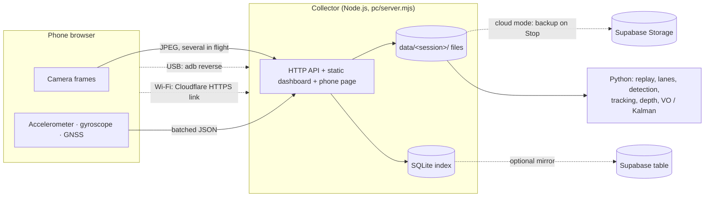
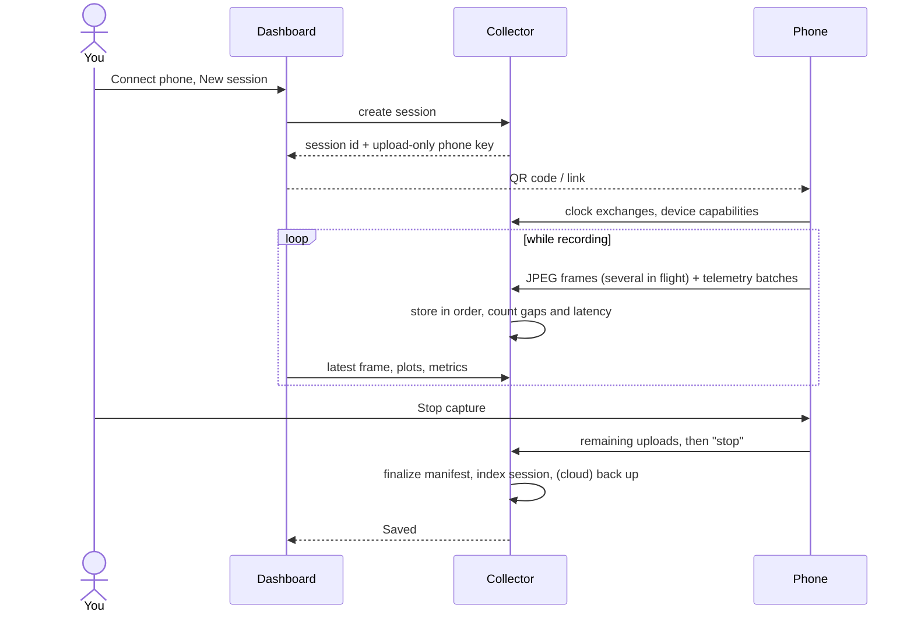
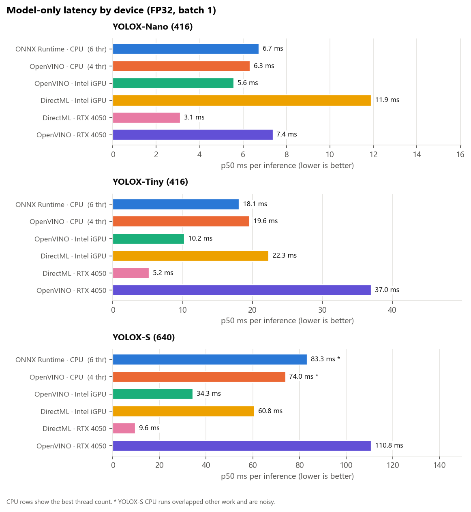
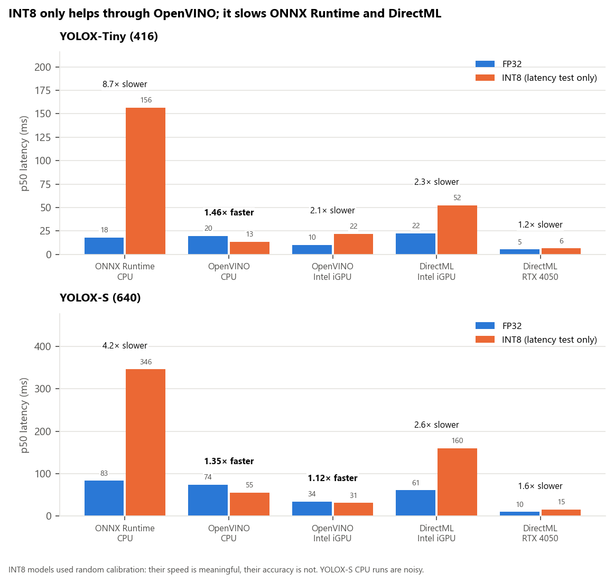

# Tepegoz

**Turn a smartphone into a timestamped camera + motion-sensor recorder, then run recorded road perception (lanes, objects, tracking, depth, motion) on a PC.**

Tepegoz is a research prototype by **DeoneAI**. A phone browser streams camera frames and sensors to a small
Node.js program (the *collector*). The collector stores every session, serves a live dashboard, and can run on
your own PC or on a free cloud host. Python tools then replay a recording and run lane, road-user, depth and
motion experiments on it.

> **Research use only.** Record road-facing video only as a passenger. Nothing here controls a vehicle or gives
> validated safety decisions. See [Scope and responsible use](#scope-and-responsible-use).

| | |
|---|---|
| **New here?** | [How to use](HOW_TO_USE.md) (step by step, with diagrams) |
| **Run it now** | `git clone https://github.com/DeoneAI/tepegoz.git` → `cd tepegoz` → `npm start` → open <http://localhost:8787> |
| **No PC running?** | [Cloud collector on Render](docs/RENDER.md) (free plan) |
| **Taking over the project?** | [Weeks 1–3 handoff](docs/handoff/START-HERE.md) |
| **What is left to do?** | [Status and TODOs](#status-and-todos) · [Progress tracker](docs/STATUS.md) · [20-day checklist](docs/ROADMAP.md) |

---

## Contents

1. [What it does](#what-it-does)
2. [Quick start](#quick-start)
3. [How it works](#how-it-works)
4. [Connecting a phone](#connecting-a-phone)
5. [Running in the cloud (Render)](#running-in-the-cloud-render)
6. [Performance and benchmarks](#performance-and-benchmarks)
7. [Data and timing contract](#data-and-timing-contract)
8. [Storage, replay and analysis](#storage-replay-and-analysis)
9. [Offline perception and estimation](#offline-perception-and-estimation)
10. [Configuration](#configuration)
11. [HTTP API](#http-api)
12. [Security and privacy](#security-and-privacy)
13. [Testing and CI](#testing-and-ci)
14. [Repository layout](#repository-layout)
15. [Status and TODOs](#status-and-todos)
16. [Documentation index](#documentation-index)
17. [Scope and responsible use](#scope-and-responsible-use)

---

## What it does

**Acquisition (browser → collector)**

- Rear-camera frames through `getUserMedia()`, uploaded as indexed, timestamped JPEGs (selectable 10/15/30 fps target and 640×360 / 1280×720).
- Accelerometer, gravity-free acceleration, gyroscope (when the browser exposes it) and optional GNSS, each with its own measured rate, sequence numbers and loss counters. **Missing sensors are reported, never invented.**
- Clock synchronization (five-exchange minimum-RTT estimate, refreshed every 15 s) so phone and PC time can be compared.
- Sensor pre-flight check, live preview, live inertial plots, stop/finalize, session library and deterministic replay.
- Several frames upload in parallel (up to 8) and are stored in order, so a slow internet round trip no longer caps the frame rate.
- Stopping on the phone uploads what is left and **saves the session automatically**.

**Where it runs**

- **On your PC**, no account and no token needed on that machine. Phone connects over USB (Android, ADB reverse) or through a free Cloudflare HTTPS link that the collector starts for you.
- **In the cloud** on Render's free plan, with recordings backed up to Supabase Storage.
- A one-click **View from another device** link opens the dashboard anywhere, already signed in.

**Storage**

- Plain files per session (`manifest.json`, `imu.csv`, `gnss.csv`, `frames.csv/.jsonl`, `telemetry.jsonl`, `clock.jsonl`, `frames/*.jpg`).
- A built-in **SQLite** index (`node:sqlite`, nothing to install) and an optional **Supabase** mirror of the session list.
- Optional offline Parquet export with typed int64 timestamps.

**Offline perception and estimation (Python, on a recording or a public dataset)**

- Classical and pretrained (YOLOP) lanes, road-user detection (six classes), temporal tracking, relative and learned metric depth, overlays and independent indexed logs.
- Gyro orientation, essential-matrix visual odometry, scalar/2D Kalman filtering, public EuRoC / KITTI imports, motion ablations and a pinned OpenVINS demonstration.
- Reproducible CPU/iGPU/GPU inference benchmarks, INT8 quantization tooling and a cloud-cost estimator.

**What is not done yet:** real-phone acceptance evidence (USB, sustained rates, gyro availability, calibration, true capture-to-display latency), the live combined runtime, and the final report/demo. See [Status and TODOs](#status-and-todos).

---

## Quick start

You need **Node.js 22.13+** and a phone with a modern browser. The collector has **no npm dependencies**.

### A. Record on your PC (normal use)

```bash
git clone https://github.com/DeoneAI/tepegoz.git
cd tepegoz
npm start
```

On Windows PowerShell use `npm.cmd start` if script policy blocks `npm`.

1. Open **<http://localhost:8787>** on the same PC. No token is needed there.
2. **Connect phone** → **Wi-Fi** (needs `winget install --id Cloudflare.cloudflared` once) or **USB · Android** (needs [Platform-Tools](https://developer.android.com/tools/releases/platform-tools)) → **Connect**.
3. **New session** → scan the QR code with the phone → **Check sensors** → **Start capture**.
4. Press **Stop capture** on the phone. The session is saved; open **Sessions → Replay**.

### B. Watch from another device

**Connect phone → View from another device → Create link**, then scan the QR code. The dashboard opens on that device already signed in.

### C. Record without a PC

Deploy to Render's free plan and open the Render address on your phone: [docs/RENDER.md](docs/RENDER.md).

### D. Run perception on public data (no phone needed)

```bash
python -m pip install -r scripts/requirements-vision.txt
python scripts/fetch_assets.py --group vision
python scripts/fetch_assets.py --group roads
python scripts/fetch_assets.py --group depth
python scripts/run_perception.py .tools/datasets/roads/solidWhiteRight.mp4 \
    --output .tools/experiments/my-run --max-frames 100 --stride 2 --depth both
```

Open `overlay.mp4` or the `previews/` images in the output folder. More in [Offline perception and estimation](#offline-perception-and-estimation).

---

## How it works



**One program, three jobs.** The collector (1) receives data from the phone, (2) serves the dashboard and the
phone capture page itself, and (3) writes recordings and the session index. There is no separate web host.



| Component | File(s) | Role |
|---|---|---|
| Collector | [`pc/server.mjs`](pc/server.mjs) | HTTP API, static files, auth, recording |
| Local trust | [`pc/local.mjs`](pc/local.mjs) | Decides when a browser on the collector PC needs no token |
| Tunnel | [`pc/tunnel.mjs`](pc/tunnel.mjs) | Starts a Cloudflare quick tunnel and reads its address |
| USB bridge | [`pc/usb.mjs`](pc/usb.mjs) | Finds an Android phone, sets up `adb reverse` |
| Session index | [`pc/store.mjs`](pc/store.mjs) | SQLite index and optional Supabase table mirror |
| Backup | [`pc/backup.mjs`](pc/backup.mjs) | Cloud mode: packs sessions into Supabase Storage and restores them |
| Replay | [`pc/replay.mjs`](pc/replay.mjs) | Deterministic replay of a saved session |
| Dashboard | [`web/index.html`](web/index.html), `web/js/dashboard/` | Live view, session library, replay, project status |
| Phone page | [`web/phone.html`](web/phone.html), `web/js/phone/` | Sensor check, capture, uploads, clock sync |

---

## Connecting a phone

| | **Wi-Fi / mobile data** | **USB (Android)** | **Cloud (Render)** |
|---|---|---|---|
| Phones | Android and iPhone | Android | Android and iPhone |
| Needs on the PC | `cloudflared` | Android Platform-Tools | nothing (no PC) |
| Needs on the phone | nothing | USB debugging | nothing |
| How the phone reaches the collector | Temporary HTTPS address (`*.trycloudflare.com`) | `adb reverse tcp:8787 tcp:8787`, phone opens `localhost:8787` | Render's HTTPS address |
| Address changes | At every collector restart | Never | Never |
| Best for | Quick tests, any network | Long or in-car recordings, steadiest rate | Recording away from your PC |

Browsers only expose camera and motion sensors on secure pages, which is why Wi-Fi needs an HTTPS link and USB
uses the phone's own `localhost`. This is **not** WebUSB or USB tethering, and it does not use Camera2.

USB check, if you want to run it by hand:

```bash
adb devices -l
adb -s SERIAL reverse tcp:8787 tcp:8787
adb -s SERIAL reverse --list
```

Details and troubleshooting: [HOW_TO_USE.md](HOW_TO_USE.md) and [docs/CONNECTING.md](docs/CONNECTING.md).

---

## Running in the cloud (Render)

The same collector runs on Render's free plan. Render's disk is temporary, so finished sessions are copied to
**Supabase Storage** and the session list is rebuilt from the Supabase table after every restart.

1. Render → **New → Blueprint** → this repository ([`render.yaml`](render.yaml)).
2. Paste `SUPABASE_URL` and `SUPABASE_SERVICE_ROLE_KEY`; Render generates `COLLECTOR_TOKEN`.
3. Open your Render address, paste the token from **Environment → COLLECTOR_TOKEN**, press **Connect**.

Free-plan limits (from [Render's docs](https://render.com/docs/free)): the service sleeps after 15 idle minutes
(about a minute to wake), the disk is wiped on restart, and 750 free hours per month apply. Heroku has had no free
plan since 2022. After code changes use **Manual Deploy → Deploy latest commit**. Full guide:
[docs/RENDER.md](docs/RENDER.md).

---

## Performance and benchmarks

### Recording frame rate

Measured with one phone recording 1280×720 to the Render collector over a connection with a 243 ms round trip.
Frame rate is computed from the stored frames' own capture timestamps.

| Collector behaviour | Frames | Captured over | FPS while capturing |
|---|---|---|---|
| One upload at a time (old) | 48 | 20.6 s | 2.3 |
| Up to 5 uploads in flight | 211 | 20.4 s | **10.3** |
| Up to 8 in flight (current default) | simulated at 250 ms round trip: 13.9 fps, none rejected, stored in order | | |

The dashboard's `fps` counts only the time frames were arriving, not the idle time before the phone started.
Tips for slow links (smaller size, nearer Render region): [HOW_TO_USE.md, section 9](HOW_TO_USE.md#9-speed-tips-why-is-my-frame-rate-low).

### Model inference on CPU, integrated GPU and GPU

Model-only latency, batch 1, synchronous single stream, 10 warm-up runs then at least 100 runs and 3 s, excluding decode,
preprocessing and NMS. Host: Intel Core 5 210H (4P + 4E cores) with Intel integrated graphics and an NVIDIA GeForce
RTX 4050 Laptop GPU, Windows 11; ONNX Runtime 1.31.1, ONNX Runtime DirectML 1.24.4, OpenVINO 2026.4.1.

| YOLOX-Tiny, FP32, p50 | Latency |
|---|---|
| ONNX Runtime, CPU (best: 6 threads) | 18.1 ms |
| OpenVINO, CPU (best: 4 threads) | 19.6 ms |
| OpenVINO, Intel iGPU | 10.2 ms |
| DirectML, Intel iGPU | 22.3 ms |
| **DirectML, RTX 4050** | **5.2 ms** |
| OpenVINO, RTX 4050 | 37.0 ms |

- **INT8 only helps through OpenVINO** (CPU 1.46× for YOLOX-Tiny, 1.35× for YOLOX-S; iGPU 1.12× for YOLOX-S). It slows ONNX Runtime and DirectML on this machine.
- 16 threads oversubscribes this 12-thread CPU and is flagged in the data.
- The YOLOX-S CPU rows are noisy (another process ran during them). INT8 models were calibrated on random data, so **only their speed is meaningful, not their accuracy**.




More charts: [thread sweep](docs/reports/benchmarks/thread_sweep.png), [tail latency](docs/reports/benchmarks/tail_latency.png),
[real-time budget](docs/reports/benchmarks/realtime_budget.png). Raw data and run settings:
[`pc-onnxruntime-openvino.csv`](docs/reports/benchmarks/pc-onnxruntime-openvino.csv),
[`pc-directml.csv`](docs/reports/benchmarks/pc-directml.csv). Regenerate the charts with
`python scripts/plot_benchmarks.py --experiments .tools/experiments --output .tools/plots`, benchmark with
`scripts/bench_inference.py`, quantize with `scripts/quantize_model.py` and estimate cloud cost with
`scripts/estimate_cloud_cost.py`.

Earlier public-data baselines (15 matched road cases, COCO subset detector comparison, EuRoC/KITTI/OpenVINS motion
results) are in [docs/reports/WEEKS-2-3.md](docs/reports/WEEKS-2-3.md).

---

## Data and timing contract

| Stream | Values / units | Coordinate frame | Source |
|---|---|---|---|
| Accelerometer | x/y/z, m/s² including gravity | Portrait phone: +X right, +Y top, +Z out of screen | `DeviceMotionEvent.accelerationIncludingGravity` |
| Linear acceleration | x/y/z, m/s² when available | Same phone frame | Browser gravity-compensated estimate |
| Gyroscope | x/y/z angular velocity, rad/s | Same phone frame | DeviceMotion `rotationRate`, or a real Generic Gyroscope fallback |
| GNSS | latitude/longitude, optional altitude/speed/heading and accuracy | WGS84 | Opt-in browser geolocation (may be fused/network fixes) |
| Camera | JPEG, index, time and its source, actual width/height | Image coordinates; extrinsics uncalibrated | Browser media capture and video-frame callback |

Every message carries `session_id`, `sensor_type`, a decimal-string monotonic `timestamp_ns`, a per-type
`sequence_id`, `frame_axes`, `values`, `units` and `quality`; each frame also carries `prev_frame_index` so the
collector can store pipelined uploads in order.

- Nanosecond units do **not** imply nanosecond precision.
- Frame times are capture, presentation or callback **estimates**; clock correction does not make them hardware exposure times.
- Ingest latency is not capture-to-display latency.
- Nearest-sample matching within **±100 ms** is an association window, not a synchronization accuracy.
- No camera intrinsics/extrinsics or vehicle/world transforms are claimed until calibrated.

**Transport:** timestamped JPEG HTTP(S) POST plus batched JSON HTTP(S) POST into a TCP-based HTTP server.
MJPEG, RTSP, WebRTC, WebSocket and custom UDP/TCP protocols are not implemented (Cloudflare's lower layers may use QUIC).

---

## Storage, replay and analysis

```text
data/
├── sessions.sqlite              session index (rebuilt from the files if missing)
└── <session-id>/                local only, never committed
    ├── manifest.json            device, capabilities, route, clocks, metrics
    ├── imu.csv                  inertial samples
    ├── gnss.csv                 location and accuracy
    ├── telemetry.jsonl          complete canonical sample messages
    ├── frames.csv / frames.jsonl
    ├── clock.jsonl
    ├── frames/00000000.jpg      accepted JPEG bytes
    └── telemetry.parquet        optional post-recording export
```

```bash
node pc/replay.mjs data/SESSION_ID                # replay as fast as possible
node pc/replay.mjs data/SESSION_ID --realtime     # original timing

python -m pip install -r scripts/requirements-analysis.txt -r scripts/requirements-vision.txt
python scripts/analyze_session.py data/SESSION_ID # alignment.csv, analysis.json, timeline.svg/png

python -m pip install -r scripts/requirements-parquet.txt
python scripts/export_parquet.py data/SESSION_ID  # typed Parquet, raw logs untouched
```

On the phone, **saved frames** counts storage acknowledgements and **skipped frames** counts frame attempts that
found every upload slot busy or failed. A lost acknowledgement can happen after a frame reached disk, so the
files and counts on the collector are authoritative. Sequence gaps and bounded-buffer drops are separate,
possibly overlapping diagnostics. Appends are flushed to disk on a PC collector (not on a cloud host, whose disk is
temporary and backed up at Stop); writes are not one atomic transaction across all files.

The Supabase mirror needs one table: run [`docs/supabase-schema.sql`](docs/supabase-schema.sql) once.

---

## Offline perception and estimation

All of this runs on the PC from Python, on a saved session or a public dataset. Models, datasets and experiment
outputs live in the ignored `.tools/` folder; selected metrics and plots are committed in `docs/reports/`.

| Area | Where | What |
|---|---|---|
| Lanes | `perception/lanes.py` | Classical and pretrained (YOLOP) lanes with confidence gating |
| Detection and tracking | `perception/models.py`, `perception/tracking.py` | Six road-user classes, temporal tracks |
| Depth | `perception/depth.py` | Relative depth and a learned metric-depth alternative, per-track depth |
| Camera motion | `perception/camera_motion.py` | Rotation cue from gyro/visual motion for track stabilization |
| Estimation | `localization/` | Scalar/2D Kalman filters, quaternion integration, essential-matrix VO |
| Evaluation | `evaluation/` | Dataset readers (EuRoC, KITTI), detection metrics, camera calibration, benchmarks |
| External VIO | `integrations/openvins/` | Pinned OpenVINS demonstration with a local adapter |

Useful commands (all take `--help`):

```bash
python scripts/fetch_assets.py --list                      # models and sample data (sizes and hashes in configs/assets.json)
python scripts/run_perception.py INPUT --output DIR        # lanes + detection + tracks + depth on frames or a video
python scripts/run_road_benchmarks.py                      # matched, serial road benchmarks
python scripts/evaluate_detector.py                        # small labeled detector comparison
python scripts/calibrate_camera.py                         # checkerboard intrinsics, held-out residuals, undistort preview
python scripts/import_kitti_session.py / import_euroc_session.py   # public data as a replayable session
python scripts/run_estimation_lab.py                       # Kalman exercises and plots
python scripts/run_motion_dataset.py / run_gyro_flow_ablation.py / run_tracking_motion_ablation.py
python scripts/run_openvins_demo.py                        # pinned external VIO demonstration
```

Relative depth stays labeled relative until independently calibrated. The local estimator is an attitude-only
experiment, **not** full VIO or SLAM.

---

## Configuration

All settings are optional environment variables. Copy [`.env.example`](.env.example) to `.env` (never commit it);
the collector loads it at start-up.

| Variable | Default | Purpose |
|---|---|---|
| `PORT` | `8787` (Render sets its own) | Collector port |
| `HOST` | `127.0.0.1` (`0.0.0.0` in cloud mode) | Listen address |
| `DATA_DIR` | `./data` | Recording directory |
| `ALLOWED_ORIGINS` | localhost origins | Extra browser origins allowed to call the API (the collector's own address is always allowed) |
| `COLLECTOR_TOKEN` | generated, stored in `data/.collector-key` | Admin token for browsers that are not the collector PC |
| `TUNNEL` | `0` | `1` starts the Wi-Fi link at launch (same as `npm run start:wifi`) |
| `ADB_PATH` | PATH or `.tools/platform-tools/adb` | Android Platform-Tools executable |
| `SUPABASE_URL`, `SUPABASE_SERVICE_ROLE_KEY` | unset | Session-list mirror and (cloud) recording backup. Use the service key only on the collector |
| `BACKUP_BUCKET` | `recordings` | Supabase Storage bucket for cloud backups |
| `COLLECTOR_CLOUD` | unset (`RENDER` is detected) | `1` = cloud mode: bind all interfaces, back up to Storage, rebuild the list from Supabase |
| `RENDER_EXTERNAL_URL` | set by Render | The collector's own public origin, allowed automatically |

### npm commands

| Command | What it does | When to use it |
|---|---|---|
| `npm start` | Starts the collector (`node pc/server.mjs`), loading `.env` if it exists. Serves the dashboard and phone page at <http://localhost:8787>, and records sessions into `data/`. Keep the terminal open while you record. | Every time you want to record or replay. |
| `npm run start:wifi` | Same as `npm start`, plus **starts the Cloudflare HTTPS link right away** (needs `cloudflared`) and prints its address. Equivalent to setting `TUNNEL=1`. | When the phone will connect over Wi-Fi or mobile data and you don't want to press **Start link** in the dashboard. Not needed for USB. |
| `npm run dev` | Currently identical to `npm start`. | Kept as the usual name for a development run; use either. |
| `npm test` | Runs all Node tests in `tests/*.test.mjs` (collector, auth, storage, replay, phone logic, session index, cloud backup, frame ordering). Needs no phone, network or install. | After changing code, and before committing. |
| `npm run token` | Prints the collector's admin token (`COLLECTOR_TOKEN`, or the one saved in `data/.collector-key`). Run `npm start` once first so the token exists. | Only to sign in by hand from another device. The **Create link** button does this for you, and the PC's own browser never needs it. Keep the token private. |

On Windows PowerShell, use `npm.cmd` instead of `npm` if script policy blocks it (for example `npm.cmd start`). The Python tools
are not npm commands: see [Offline perception and estimation](#offline-perception-and-estimation).

---

## HTTP API

Admin routes need the collector token (or a trusted local browser); phone routes need that session's upload-only key.

| Route | Who | Purpose |
|---|---|---|
| `GET /health` | anyone | Liveness, `cloud` flag |
| `GET/POST /api/sessions` | admin | List sessions; create one (returns session id and phone key) |
| `GET /api/sessions/:id` | admin | Session state or stored manifest |
| `POST …/:id/device`, `/clock`, `/sync` | phone | Capabilities, clock log, clock exchange |
| `POST …/:id/frame` | phone | One JPEG (`X-Frame-Meta` header: index, `prev_frame_index`, time, size) |
| `POST …/:id/samples` | phone | Batched sensor samples |
| `POST …/:id/stop` | admin or that session's phone | Finalize the session |
| `GET …/:id/live-image`, `/image?index=N` | admin | Latest or a stored frame |
| `GET …/:id/replay`, `/export?file=…` | admin | Replay data; download a log file |
| `GET /api/connection`, `POST /api/tunnel`, `POST /api/remote-link` | trusted local browser only | Start/inspect the Wi-Fi link; create the "other device" link |
| `GET/POST /api/usb` | trusted local browser only | Find a phone, set up `adb reverse` |

---

## Security and privacy

- **No token on the collector PC.** A browser is trusted without a token only if the socket is loopback, the `Host` is `localhost:<port>`, no proxy or Cloudflare headers are present, the `Origin` is same-origin and `Sec-Fetch-Site` is `same-origin` or `none`. Anything arriving through the tunnel, another site or DNS rebinding is **not** trusted.
- **Everyone else uses the collector token**, kept in `data/.collector-key` (or `COLLECTOR_TOKEN`). Treat it like a password.
- **Phones get an upload-only key per session.** It can send frames, samples, clock and device data, and stop its own session; it cannot list or read anything.
- **Exact-origin allow-list** for cross-origin calls; phone and USB administration only from the local PC.
- **The "other device" link** carries the address and token after `#`, which browsers never send over the network; the receiving page saves them and clears the address bar. Anyone holding the link can control the collector until it restarts, so keep it private.
- **Cloud mode** uses `COLLECTOR_TOKEN` from Render's environment and the Supabase service key; neither is ever shown to the phone or committed.
- Camera, motion and optional location data stay in the collector's recording directory (and, in cloud mode, in your own Supabase project). Audio is not collected. Keep tokens, phone links, recordings, `.env` and local tools out of Git; the ignore rules cover the defaults.

---

## Testing and CI

```bash
npm test                                         # Node: collector, auth, storage, replay, phone logic, store, backup, frame order
python -m pip install -r scripts/requirements-parquet.txt -r scripts/requirements-analysis.txt -r scripts/requirements-vision.txt
python -m unittest discover -s tests -p "test_*.py"   # Python: perception, calibration, datasets, Parquet
```

GitHub Actions ([`.github/workflows/ci.yml`](.github/workflows/ci.yml)) runs the Node tests and the Python checks. No automated job can prove
phone hardware performance; [docs/VALIDATION.md](docs/VALIDATION.md) records what was actually run and its limits.

---

## Repository layout

```text
pc/                      collector, local trust, tunnel, USB bridge, session index, cloud backup, replay
web/                     dashboard (index.html), phone capture page (phone.html), styles, assets
scripts/                 asset fetch, dataset imports, offline inference, benchmarks, quantization, plots
perception/              lane / detector / depth adapters, tracking, camera rotation, rendering
localization/            Kalman filters, quaternion integration, essential-matrix VO
evaluation/              dataset readers, detection metrics, camera calibration, runtime summaries
integrations/openvins/   pinned external VIO demonstration and adapter
configs/                 model/sample asset registry, class taxonomy, example calibration and pricing
tests/                   Node and Python tests
docs/                    guides, status, roadmap, validation, handoff, reports and diagrams
render.yaml              Render Blueprint (cloud collector)
HOW_TO_USE.md            step-by-step guide
```

`data/`, `.tools/`, `.venv/` and `.env` are local-only and ignored.

---

## Status and TODOs

**Where the project stands:** Weeks 2–3 baselines run on public data; Week 1 physical acceptance and Week 2 lane-quality
acceptance are partial; Week 4 (integration and submission) is pending. Checkboxes below are the working list. Keep
[docs/STATUS.md](docs/STATUS.md) and [docs/ROADMAP.md](docs/ROADMAP.md) in step when something changes.

| Milestone | Days | Outcome required | State |
|---|---|---|---|
| W1 Acquisition | 1–5 | Receive, synchronize, log and replay camera + IMU | Software done; **physical gate partial** |
| W2 Road perception | 6–10 | Lane and object/tracking baselines on one indexed sequence | Baselines done; **quality acceptance partial** |
| W3 Depth and motion | 11–15 | Per-object depth, IMU orientation, first justified fusion | Public-data baseline done; **phone workflow pending** |
| W4 Integration | 16–20 | Combined runtime, evaluation, report, demo | **Pending** |

### Done recently

- [x] Collector on one port serving dashboard and phone page; no token on the collector PC.
- [x] Wi-Fi link started by the collector; USB setup from the same dialog; one-click **View from another device**.
- [x] SQLite session index and optional Supabase mirror.
- [x] Cloud collector on Render with Supabase Storage backup and list restore; tested through a simulated restart.
- [x] Pipelined frame upload with ordered storage (2.3 → 10.3 fps measured on the cloud route); accurate fps metric.
- [x] Phone **Stop** saves the session; dashboard no longer waits for a click.
- [x] CPU / iGPU / GPU inference benchmarks, INT8 quantization tooling, plots and cost estimator.
- [x] Vercel removed; docs and diagrams rewritten for the current setup.

### 1. Phone acquisition and hardware acceptance (W1)

- [ ] Confirm the exact sensor inventory and sustained rates on each target phone model.
- [ ] Obtain real gyroscope data, or choose a native/hardware route if the browser cannot provide it (never synthetic values).
- [ ] Validate a real authorized USB phone, unplug/replug recovery and an Internet-free data path.
- [ ] Measure true **capture-to-display latency** with an external visual/event experiment.
- [ ] Find sustainable settings at the target resolution and rate; separate camera settings, requested JPEG fps and saved fps.
- [ ] Record checkerboard images, estimate intrinsics/distortion and measure the mount transform (phone calibration is still unclaimed).
- [ ] Validate timestamp quality and frame↔IMU error on controlled motion.
- [ ] Run the stress matrix: indoor, stationary/rotation, walking/handheld, and safely recorded passenger-only road-facing.
- [ ] Compare USB and tunnel at matched settings, including interruption, permission denial and screen-lock behavior.
- [ ] Publish achieved fps/Hz, p50/p95 latency (with its definition), jitter, sequence gaps, drops and skipped frames.
- [ ] Deliver a compliant **two-minute camera + accelerometer + gyroscope recording** with deterministic replay and a timeline.

### 2. Road perception (W2)

- [ ] Finish the Day 7 temporal and day/night lane-quality review (continuity, missing and false markings).
- [ ] Validate lanes, detection and tracking on real phone footage, not only public clips.
- [ ] Report class-specific detection errors and ID-switch evidence on labeled data.

### 3. Depth and motion (W3)

- [ ] Phone orientation/yaw export adapter, and derived-session image/calibration preparation.
- [ ] Compare RGB-only against motion-assisted filtering on phone data, including negative results.
- [ ] Attach per-track depth with timestamps and check depth consistency.

### 4. Integration and deliverables (W4)

- [ ] Define typed `Frame`, `IMUSample`, `LaneEstimate`, `Detection`, `Track`, `DepthEstimate`, `EgoMotionEstimate`; set capture-time bases, bounded queues, confidence and staleness.
- [ ] One aligned runtime: lanes + detection/tracking + depth + orientation, with graceful degradation (missing IMU, weak light, overload).
- [ ] Profile every module separately and together; never quote detector-only fps as end-to-end fps.
- [ ] Live phone ingest and replay with all overlays; three successes and three failures with metrics and a latency budget.
- [ ] Code, a **5–8 page report**, benchmark CSVs and a **3–5 minute demo video**; the separate **5–8 minute technical defense**.
- [ ] A consented, sanitized example session (manifest, clock basis, calibration, field descriptions) for the repository.
- [ ] Month 2 priorities written from measured limits.

### 5. Models, data and training (research)

- [ ] Decide **commercial vs research-only use**; it decides which datasets (BDD100K, MTSD, KITTI) and models (Ultralytics, AGPL) are allowed.
- [ ] Settle the 8-class taxonomy (`configs/class_taxonomy.json`) and a 20k-image mix of BDD100K, COCO, Mapillary signs, IDD and own phone frames, with a held-out test set that is never used for training or calibration.
- [ ] Fine-tune and compare **DEIM-D-FINE-N** and **RF-DETR-Nano** against the YOLOX-Tiny baseline.
- [ ] Quantize with 100–500 **real road** calibration images and gate on accuracy (mAP drop ≤ 1 point, no must-have class losing more than 2 points of recall).
- [ ] Investigate why INT8 slows ONNX Runtime and DirectML here; rerun the YOLOX-S CPU rows without other load.
- [ ] Compare ByteTrack, OC-SORT and BoT-SORT on labeled road clips (HOTA, IDF1, ID switches).
- [ ] Build the second-stage traffic-sign classifier and test an open-set obstacle approach.

### 6. Product and operations

- [ ] Recreate the Render service in the **Frankfurt** region (the current one is likely far away); connect GitHub for automatic deploys.
- [ ] Delete the old `tepegoz-deone.vercel.app` project in Vercel (the repo no longer uses it).
- [ ] Delete / archive sessions from the dashboard, and a retention rule for the 1 GB Supabase free storage.
- [ ] Token rotation (regenerate `COLLECTOR_TOKEN` without editing files) and an optional per-device share link that expires.
- [ ] Adaptive upload (reduce size or rate automatically when frames start being skipped).
- [ ] Add an in-browser demo/sample session so the project can be tried without a phone.
- [ ] Evaluate WebSocket or WebRTC transport against the current HTTP POST path.

---

## Documentation index

| Document | What it covers |
|---|---|
| [HOW_TO_USE.md](HOW_TO_USE.md) | Step-by-step usage, connection options, cloud, speed tips, troubleshooting |
| [docs/CONNECTING.md](docs/CONNECTING.md) | Connection design, Supabase session list, where sessions are stored |
| [docs/RENDER.md](docs/RENDER.md) | Cloud collector on Render, limits, updating, region |
| [docs/STATUS.md](docs/STATUS.md) | Progress tracker and next work |
| [docs/ROADMAP.md](docs/ROADMAP.md) | The 20-day checklist with acceptance evidence |
| [docs/VALIDATION.md](docs/VALIDATION.md) | What was run, what passed, and the limits |
| [docs/handoff/](docs/handoff/START-HERE.md) | Fresh-PC setup, week-by-week guides, evidence template |
| [docs/reports/](docs/reports/WEEKS-2-3.md) | Measured results, audits, benchmark data and figures |
| [docs/roadmap/assignment.pdf](docs/roadmap/assignment.pdf) | The supplied one-month assignment |
| [docs/supabase-schema.sql](docs/supabase-schema.sql) | Table for the Supabase session mirror |
| [docs/diagrams/](docs/diagrams/radar.mmd) | Transport radar and coordinate-frame diagrams |

---

## Scope and responsible use

This is a research prototype for recorded or passenger-only observations. It does not control steering or braking and
gives no validated road-safety decision. Relative depth must stay labeled relative until independently calibrated and
evaluated, and browser timestamps remain estimates.

Camera, motion and optional location data stay in the configured recording directory. The Wi-Fi route passes through
Cloudflare's tunnel service; the cloud route passes through Render and your Supabase project. Audio is not collected.
Models and datasets keep their own licences (see `configs/assets.json` for sources and hashes); check each licence before
any commercial use.
