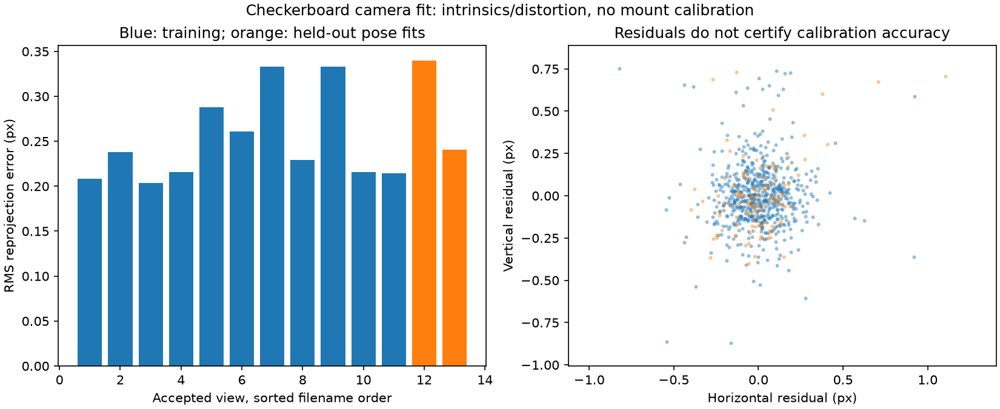

# Camera calibration workflow

The checkerboard tool estimates a pinhole camera's intrinsics and five Brown–Conrady distortion coefficients. It saves detected-corner previews, per-view reprojection errors, a held-out-view diagnostic and an undistorted preview. It does not estimate camera/IMU timing, `R_body_camera` or the phone-to-vehicle mount transform.

## Reproduce with public images

```bash
python -m pip install -r scripts/requirements-vision.txt
python scripts/fetch_assets.py --group calibration
python scripts/calibrate_camera.py .tools/datasets/opencv-calibration --output .tools/experiments/my-calibration --columns 9 --rows 6
```

The registry pins 13 OpenCV `4.12.0` sample images by size/SHA-256. This example uses nine by six **internal corners**, not square counts. The public board's physical square size is unknown, so board translations stay in board-square units. Intrinsics and reprojection residuals are in pixels. The tool leaves both mount transforms null.

The executed public example used 11 training images and 2 held out. Training RMS was **0.2531 px**; held-out pose-fit RMS values were **0.3395 px** and **0.2408 px**. Estimated focal lengths were approximately **532.51/532.59 px** at 640×480. These are fitted sample-camera parameters, not this user's phone calibration. See the [full report](reports/camera-calibration-public.json).



## Use actual phone checkerboard images

1. Use the same physical lens, resolution, crop, zoom, focus and stabilization settings as the intended recording. A changed camera configuration can invalidate the fit. The browser may not expose manual controls; record what is actually available.
2. Capture at least 12 distinct clear views for the default split: ten training plus two held out. More diverse views are preferable. Move/tilt a flat target across the image, including corners and edges; avoid motion blur, glare, a bent print and repeated near-identical poses.
3. Copy selected raw JPEGs/PNGs into a separate local folder. Measure the **printed** square edge if metric board-pose translation is needed. Do not infer its size from printer settings.
4. Run the tool with the actual internal-corner dimensions and measured size. For example, only if the measured square is 25 mm:

```bash
python scripts/calibrate_camera.py data/my-checkerboard-images --output .tools/experiments/my-phone-calibration --columns 9 --rows 6 --square-size-m 0.025
```

The tool requires a separate empty output folder. It excludes duplicate image bytes and effectively identical corner geometry, skips undetected targets, and rejects mixed image sizes. By default, the final two accepted images in sorted filename order are held out; choose `--holdout N` explicitly to change this. No hidden error-based pruning or best-case split is performed.

Review `corners/`, `reprojection.png`, `undistorted-preview.jpg` and `camera-calibration.json`. Revisit captures if corners are wrong, views lack tilt/coverage or residuals have structure. The current diversity and 1 px warning thresholds are documented heuristics, not acceptance standards. Missing warnings and low RMS do not certify a camera model, depth scale or accurate navigation.

## What the held-out diagnostic proves

Only training views fit K and distortion. Held-out images keep those parameters fixed and fit their own six-DOF board pose with `solvePnP`; the report calls this `held_out_pose_fit`. It tests how well the recovered camera model explains additional views, while still allowing pose adjustment. It is not an independent ground-truth camera-parameter or reference-distance test. Tests verify that corrupting held-out corners changes their errors without supplying them to the intrinsic fit.

Raw K and distortion describe the original images. `undistorted_intrinsics` describes the full-size undistorted preview; the reported ROI marks valid pixels, and border pixels may be invalid. Cropping/resizing requires changing K consistently. The tool generates a preview, not a transformed recording.

Do not use this result directly as the motion-assistance calibration: that path requires matching undistorted/rectified saved images and K, measured camera-to-IMU axes, and image dimensions. Here `R_body_camera` remains null and is rejected by the adapter. Checkerboard-to-camera poses in `views` are different transforms and must never be copied into the mount field. Public EuRoC/KITTI imports already perform their documented image/calibration preparation.

The [OpenCV calibration tutorial](https://docs.opencv.org/4.x/dc/dbb/tutorial_py_calibration.html) explains projection, distortion and checkerboards; its [calibration API](https://docs.opencv.org/4.x/d9/d0c/group__calib3d.html) documents the underlying functions. The [sample code](https://github.com/opencv/opencv/blob/4.12.0/samples/cpp/stereo_calib.cpp) uses the selected 9×6 board. Original sample imagery remains under ignored `.tools/`; the report includes only derived numerical diagnostics and a residual plot.
