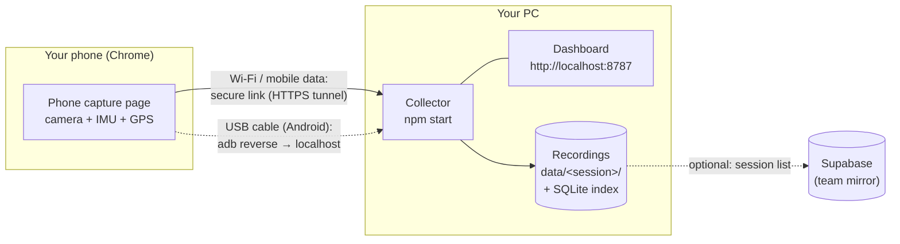
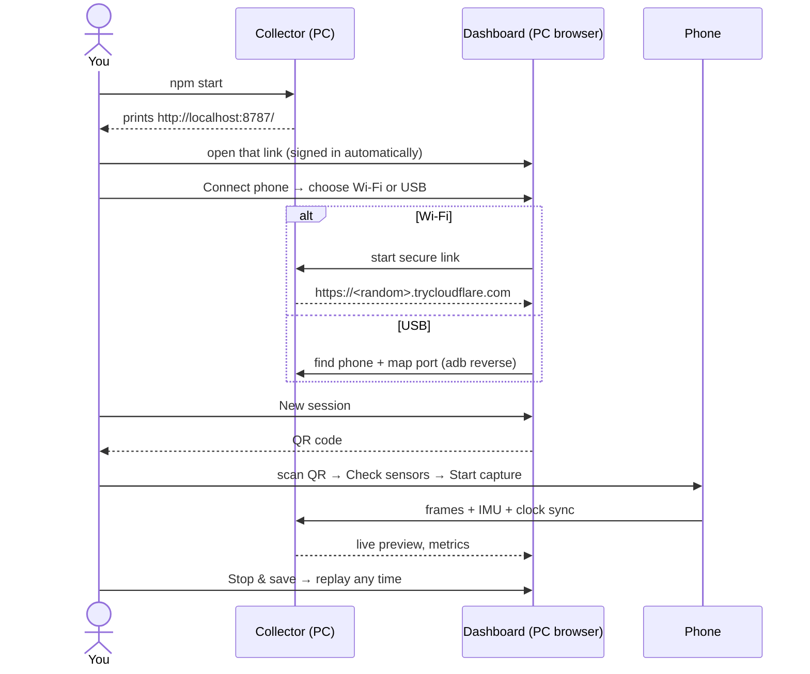
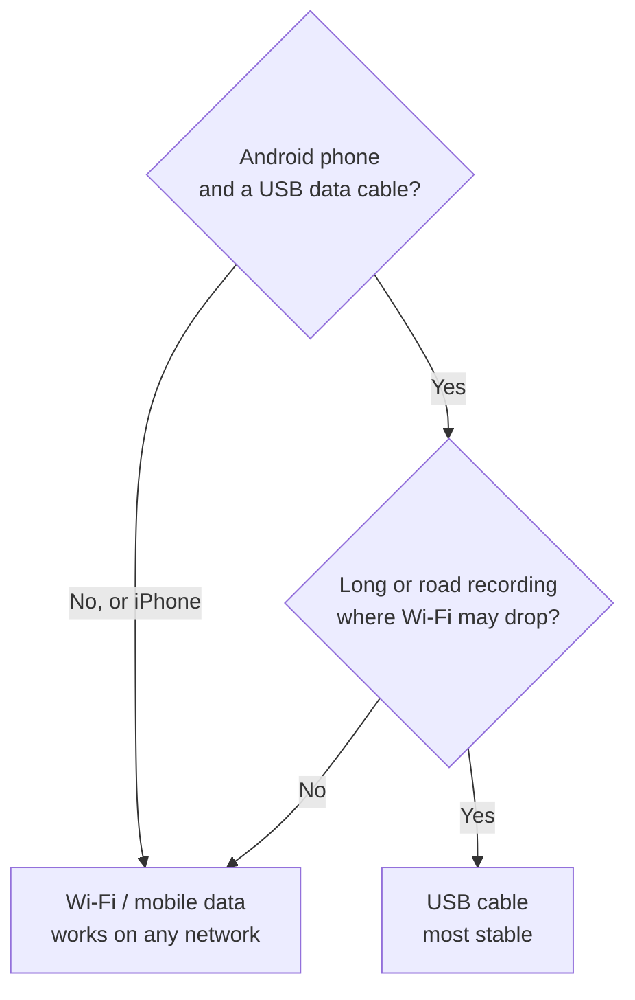

# Connecting a phone to Tepegoz

You only need **one thing running: the collector on your PC**. It stores every recording, serves the
dashboard and the phone page, and (for Wi-Fi) opens the secure link for you. Vercel and manual
Cloudflare commands are no longer part of the normal setup.

## The whole picture



## Three steps



## Which route should I pick?



| | Wi-Fi / mobile data | USB cable |
|---|---|---|
| Phones | Android and iPhone | Android only |
| One-time install on the PC | `winget install --id Cloudflare.cloudflared` | Android Platform-Tools (ADB) |
| One-time on the phone | nothing | Developer options → USB debugging |
| Why it works | The secure link gives the phone an HTTPS page, which browsers require for camera and motion sensors | The phone opens its own `localhost`, which browsers treat as secure |

## What changed (and what you no longer need)

| Before | Now |
|---|---|
| Copy a 64-character token into a form | Open the sign-in link the collector prints |
| Run `cloudflared` in a second terminal and paste its URL | The dashboard starts the secure link (or `npm run start:wifi`) |
| Add the Vercel site to `ALLOWED_ORIGINS` and restart | Not needed: the phone page comes from the collector through the link |
| Use the Vercel site | Optional, only to view the dashboard from another computer (Advanced in the dialog) |

## Where are my sessions?

Always on the PC, in `data/<session-id>/` (JPEG frames, `imu.csv`, `gnss.csv`, `telemetry.jsonl`,
`clock.jsonl`, `manifest.json`). The collector keeps an index in `data/sessions.sqlite` (SQLite built into
Node, no install) so the library is fast and survives restarts. If the dashboard shows *Collector offline*,
the files are still there: the page is just not connected to the collector.

### Optional: share the session list with Supabase (free tier)

1. Create a project at supabase.com and run this in the SQL editor:

   ```sql
   create table public.sessions (
     id text primary key,
     name text not null,
     created_at timestamptz not null,
     ended_at timestamptz,
     status text not null,
     connection_mode text,
     frames integer,
     samples integer,
     duration_s double precision,
     device_user_agent text,
     manifest jsonb not null,
     updated_at timestamptz not null default now()
   );
   alter table public.sessions enable row level security;
   ```

2. Copy `.env.example` to `.env` and fill `SUPABASE_URL` and `SUPABASE_SERVICE_ROLE_KEY`
   (Project Settings → API). Keep `.env` on the collector PC only; it is git-ignored.
3. `npm start`. The start-up banner shows `SQLite + Supabase mirror`. Only metadata is mirrored;
   frames and raw IMU never leave the PC. If Supabase is unreachable, recording continues and the
   mirror catches up at the next start (existing sessions are re-sent on start-up).
