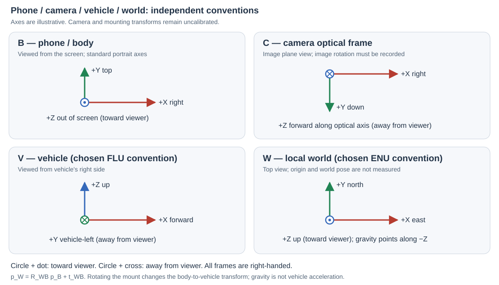

# Coordinate frames and recorded timing evidence

These conventions support Week 1 and the technical addendum. The diagram defines frames, not measured calibration or an implemented vehicle/world transform.



## Frames and gravity

| Frame | Convention | Current evidence |
|---|---|---|
| B: phone/body | +X screen-right, +Y screen-top, +Z out of screen in standard portrait orientation | Acquisition schema; axes remain attached to the device when display orientation changes |
| C: camera optical | +X image-right, +Y image-down, +Z forward along the optical axis | Convention for future OpenCV processing; camera orientation, distortion and B↔C extrinsics require measurement |
| V: vehicle | Chosen right-handed FLU: +X forward, +Y left, +Z up | Proposed project convention; no mount transform has been measured |
| W: local world | Chosen right-handed ENU: +X east, +Y north, +Z up | Proposed local convention; origin and pose have not been established; GNSS remains geodetic |

`R_AB` rotates components expressed in frame B into frame A. For a point, `p_A = R_AB p_B + t_AB`, where `t_AB` is the position of B's origin expressed in A. For a vector such as angular velocity, rotate without translation. The inverse point transform uses `R_BA = R_ABᵀ` and `t_BA = −R_ABᵀ t_AB`. For example, `p_W = R_WB p_B + t_WB`. No unknown transform should be filled with an identity matrix merely to produce an overlay.

Gravity in the chosen world frame is approximately `g_W = [0, 0, −9.81] m/s²`. A physical accelerometer measures specific force with bias/noise: `f_B ≈ R_BW(a_W − g_W) + b_a + n_a`, hence `a_W ≈ R_WB(f_B − b_a) + g_W` when the required orientation and bias are known. At rest, specific force opposes gravity; it does not imply that the vehicle is accelerating upward. The browser's `acceleration` is an optional gravity-compensated estimate, while `accelerationIncludingGravity` includes the gravity response. Validate actual signs with stationary and controlled-rotation recordings before using either in navigation. The current collector does not perform this world-frame conversion.

Phone gyro values are angular rates in rad/s in B. A phone's Z axis need not point up in the vehicle: integrating gyro Z is not automatically vehicle yaw or compass heading. Remounting the phone changes B↔V, even if browser display rotation preserves B. A rear camera, front camera, display rotation, crop or mirrored preview must not be used to assume a measured B↔C transform.

Sources: [W3C device coordinates and motion](https://www.w3.org/TR/orientation-event/), [OpenCV camera coordinates and projection](https://docs.opencv.org/4.x/d9/d0c/group__calib3d.html). FLU/ENU above are explicit project choices, not claims that the browser reports vehicle/world coordinates.

## Generate timing evidence from a saved session

Requires Python 3.10+. Analysis and CSV export use the standard library. Matplotlib is needed only for plots:

```bash
python -m pip install -r scripts/requirements-analysis.txt
python scripts/analyze_session.py data/SESSION_ID
```

Without plotting dependencies:

```bash
python scripts/analyze_session.py data/SESSION_ID --no-plot
```

The tool accepts finalized (`completed` or `interrupted`) sessions, rejects active recordings and recorded storage errors, and leaves raw files unchanged. An interrupted session remains a warning. Outputs go into `SESSION/analysis/`; override with `--output PATH`. Keep outputs beside private recordings or in another ignored/private directory.

| Output | Evidence |
|---|---|
| `analysis.json` | Per-stream counts, source-time spans and rates, sequence gaps/duplicates, timestamp regressions, frame↔sensor coverage and absolute matching deltas, missing/orphan JPEG names, recorded metrics and unmodified calibration metadata |
| `alignment.csv` | Frame index/time/source and nearest per-type sample ID/time/signed delta; missing associations are empty fields |
| `timeline.svg`, `timeline.png` | Shared recorded-time axis: camera/IMU event rows, three-axis acceleration and gyro, and signed nearest-match deltas; missing streams are labeled |

Timestamp subtraction uses Python integers before conversion to seconds/milliseconds. The nearest-sample rule uses the same earlier-on-tie choice and default inclusive ±100 ms window as replay. `--max-gap-ms N` changes the analysis window only; the report records it and does not reconfigure replay. Plotted signal lines break at gaps greater than the larger of 250 ms or five times that stream's median positive interval. Plot lines are visual connections, not interpolated measurements.

The common camera/accelerometer/gyro overlap is the intersection of their timestamp ranges. A 120-second overlap is a useful prerequisite, but sparse endpoints or large gaps can still occur inside it. Review rates, missing matches, sequence diagnostics, raw logs and the [physical test sheet](STRESS-TEST.md) together. Automated checks never mark W1 accepted.

## Interpret timing correctly

- Frame and IMU associations compare original timestamps in the same phone monotonic domain. No server offset is needed for this comparison, and wall-clock GNSS times must not be compared directly.
- Clock exchanges estimate server-minus-phone offset and transit RTT. Offset correction does not recover a camera exposure timestamp or remove rolling shutter and browser buffering.
- `captureTime`, presentation estimates and callback estimates remain separate provenance labels. A large or negative nearest delta describes an association, not network latency.
- The analysis window is a maximum allowed association mismatch, not a synchronization error bound. Empty matches remain missing; gyro is never reconstructed from orientation.
- Ingest metrics copied from the manifest are recording-time diagnostics, not newly measured capture-to-display latency. Calibration fields stay null until measured.

The remaining required evidence is a plot from real phone data, measured static/rotation behavior, the camera/mount calibration record and the external capture-to-display experiment. Synthetic fixtures used to test this tool are not physical acceptance evidence.

Public EuRoC and KITTI imports also use this analyzer, preserving their explicit `time_basis`, `source_type` and native axes from the manifest. They do not acquire phone axes or a phone/PC clock exchange. [Public-data plots and measured associations](reports/WEEKS-2-3.md) now exist; the physical phone checks above remain pending.
