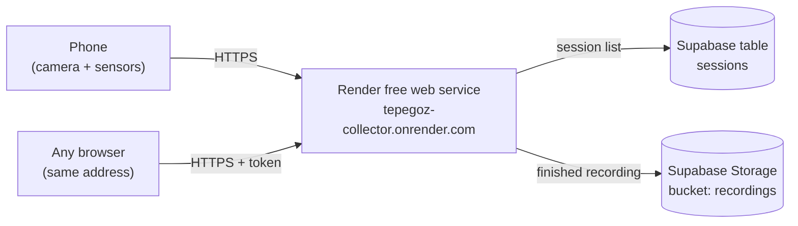

# Run the collector in the cloud (Render, free)

Use this when you do **not** want to keep a PC running. The collector runs on [Render](https://render.com/docs/free)'s
free plan; the phone opens the Render address directly (it is already HTTPS), so no Cloudflare link, no USB and no
Vercel are involved. Recordings are copied to **Supabase Storage** (free) because Render's disk is temporary.

> Heroku has had no free plan since November 2022 (its cheapest, Eco, is about $5/month), so this guide uses Render.

## Set it up (about 10 minutes, once)

1. Create a free account at <https://render.com> (**Sign in with GitHub** is easiest). No card is needed for the free plan.
2. **New + → Blueprint**, choose the `DeoneAI/tepegoz` repository (allow Render to read it when asked), then **Apply**.
   `render.yaml` in the repo already describes the service.
3. When Render asks for the two secret values, paste them from your local `.env`:
   - `SUPABASE_URL`
   - `SUPABASE_SERVICE_ROLE_KEY`

   Render generates `COLLECTOR_TOKEN` for you. The Supabase bucket `recordings` is created automatically on the first backup.
4. Wait for the deploy to finish. Your address looks like `https://tepegoz-collector.onrender.com`.
5. Open that address. In **Connect to your collector** the address is already filled in. For the token open the service in
   Render → **Environment** → `COLLECTOR_TOKEN` → show → copy, paste it, press **Connect**.
6. **New session**, scan the QR code with the phone. It opens the same Render address.

Shortcut that skips typing: open
`https://YOUR-SERVICE.onrender.com/#collector=https://YOUR-SERVICE.onrender.com&token=YOUR_TOKEN` once on a device.
The part after `#` stays in the browser and is removed from the address bar.

## Updating after a code change

Render read the repository by its public URL, so it does **not** redeploy on every push. After new commits on `main`: open the service in Render → **Manual Deploy → Deploy latest commit**. (Connecting your GitHub account to Render instead enables automatic deploys.)

## Speed (frames per second)

The phone keeps up to 5 frames uploading at once, so the round-trip time to the server matters much less than before. Distance still adds delay: the collector runs in the Render region chosen when the service was created (the default is Oregon, USA). From Europe or the Caucasus, create the service in **Frankfurt** instead (Render → New → Blueprint, choose the Frankfurt region; a region cannot be changed later). If the frame rate is still low, choose **640×360** on the phone page: it sends about a quarter of the data.

## What to expect on the free plan

| Limit (Render free) | What it means here |
|---|---|
| Sleeps after 15 minutes without traffic | The first page load after a break takes about a minute. Open the dashboard **before** you go out to record. A recording keeps it awake, because the phone is sending data. |
| Temporary disk (wiped on restart/sleep) | Finished sessions are uploaded to Supabase when you press **Stop & save**, and downloaded again when you open them. **A recording that is cut off before Stop is saved only up to the last restart**, so always stop it. |
| 750 free hours a month | Enough for one always-awake service. |
| Supabase free storage: 1 GB | Roughly 100 short sessions (a 200-frame test is about 8 MB). Delete old ones in Supabase when it fills up. |
| Small shared CPU | Recording and the live view are fine. Run the heavy offline detection and lane tools on your own computer after downloading the session. |

## Keeping the PC option

Nothing changes locally: `npm start` and `http://localhost:8787` still work exactly as before, with no token. Both can share the same
Supabase project, so sessions recorded in the cloud show up in the local list as well.

## Troubleshooting

| Problem | Fix |
|---|---|
| Page does not load, spinner for a minute | The free service was asleep. Wait, then reload. |
| 401 / "Invalid pairing key or collector token" | Copy `COLLECTOR_TOKEN` again from Render → Environment. |
| Library empty after a restart | Check the Render logs for `Supabase list unavailable`; verify the two Supabase values. |
| Log says `NOTHING: set SUPABASE_URL…` | The backup is off; add both values under Environment and redeploy. |
