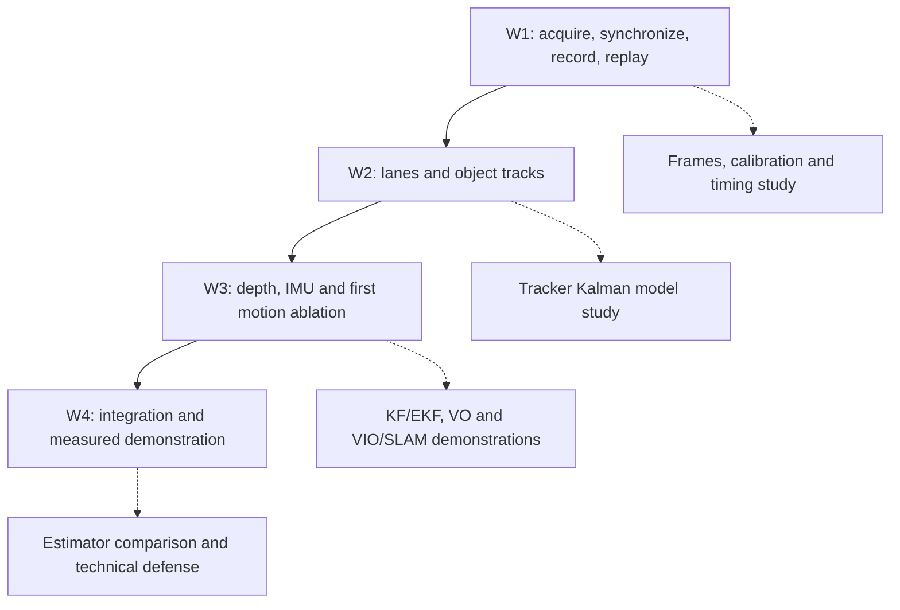

# Project roadmap and TODOs

Source: the supplied [one-month assignment and technical learning addendum](roadmap/assignment.pdf), 20 working days. This is a requirements-to-evidence checklist, not a claim that the project has completed the month. Day numbers describe the source plan, not calendar deadlines.

**Current implementation:** browser acquisition, PC logging/replay and executable Weeks 2–3 perception/estimation baselines. **Evidence scope:** public datasets, as requested while no phone recording is available. W1 physical acceptance remains partial; see [measured results](reports/WEEKS-2-3.md) and [current status](STATUS.md). Checked learning items mean code/documented demonstrations exist, not that the learner has completed a technical defense.

## Priorities and gates

| Priority | Scope |
|---|---|
| Must | Timestamped sensor stream, alignment, lanes, road-user detection/tracking, depth, integrated visualization and metrics |
| Should | IMU orientation, motion-aware temporal filtering, calibrated camera and explicit coordinate frames |
| Stretch | Full custom VIO/SLAM, validated metric object distance, temporal BEV, object velocity and risk/TTC forecasting |

## Week 1 — acquisition and synchronization (Days 1–5)

Outcome: stable, timestamped multi-sensor ingest. The phone acquires data; the PC runs analysis/inference. Detailed software status is in the [README](../README.md#week-1-task-status).

### Day 1 — research sensors and streaming options

- [x] Document sensors, units, phone axes, browser/native API boundaries, permissions and privacy.
- [x] Compare Android Camera2/SensorManager, iOS AVFoundation/Core Motion, existing tools and a custom client.
- [x] Compare USB/Wi-Fi, frame transports and telemetry transports; document the selected stack and its deviation from the listed video protocols.
- [ ] Confirm exact sensor inventory and sustained rates on each physical target model.

### Day 2 — implement sensor telemetry

- [x] Implement accelerometer, available gyro and opt-in GNSS sending with explicit units and measured per-sensor rates.
- [x] Define/validate schema v2: session, sensor, monotonic time, axes, values, units, quality/accuracy and sequence ID.
- [x] Implement PC receiver, inertial plots, inventory, sequence/buffer loss diagnostics, live CSV/JSONL and optional offline Parquet export.
- [ ] Verify real gyro data, sustained device rates, GNSS accuracy behavior and loss/retry behavior with a physical phone.
- [x] Select live CSV/JSONL logging plus optional finalized-session Parquet export. The source specifies CSV/Parquet logging and does not explicitly require live Parquet append.

### Day 3 — implement camera streaming

- [x] Send RGB JPEGs with frame index, timestamp and timestamp-source label; preserve accepted JPEG bytes.
- [x] Provide initial camera constraints, selectable JPEG settings, preview, connection state and recording controls.
- [ ] Measure actual capture-to-display latency with an external visual/event experiment; ingest latency is insufficient.
- [ ] Establish sustainable settings at the target resolution/rate; distinguish camera settings, requested JPEG FPS and saved FPS.
- [x] Record the justified JPEG-POST stack choice and comparison with MJPEG/RTSP/WebRTC. The implementation does not claim those protocols; a stricter external rubric would require revisiting this documented design choice.

### Day 4 — synchronize and calibrate

- [x] Document clock domains, monotonic time, transit delay, offset/drift and asymmetry limits.
- [x] Implement minimum-RTT clock estimates, periodic resync, same-phone-clock nearest matching and explicit missing associations.
- [x] Explain nearest vs interpolation and preserve uncalibrated/null intrinsics/extrinsics.
- [ ] Record checkerboard images when practical, estimate intrinsics/distortion, report reprojection error and measure the mount transform.
- Preparation: [checkerboard CLI](CALIBRATION.md) is implemented and validated on public samples; phone capture and the mount transform above still require physical evidence.
- [ ] Validate timestamp quality and frame↔IMU errors on controlled motion; ±100 ms matching is not a timing accuracy claim.
- [x] Add the addendum's explicit [phone/body-camera-vehicle-world axes diagram](FRAMES-AND-TIMING.md), transform notation and gravity explanation.
- [x] Implement offline shared-time gyro/acceleration/video plots and frame-to-IMU alignment CSV/report export.
- [ ] Generate and interpret the synchronized timeline from a real compliant phone recording; synthetic QA is not acceptance evidence.

### Day 5 — stress test and document

- [x] Deliver runnable acquisition, PC logging/replay, run instructions and a concise [decision note](DESIGN.md).
- [x] Implement runtime metric collection and prepare the [physical acceptance sheet](STRESS-TEST.md).
- [ ] Execute indoor, stationary/rotation, walking/handheld and safely recorded passenger-only road-facing tests.
- [ ] Compare real USB and tunnel routes, including interruption/recovery, permission denial and background/screen-lock behavior.
- [ ] Publish achieved FPS/IMU Hz, p50/p95 latency with its definition, jitter, sequence gaps, buffer drops and skipped frames.
- [ ] Deliver a compliant **two-minute camera + accelerometer + gyroscope recording and replay**, with clock basis and calibration notes.

**Gate W1:** every saved frame has a defensible capture-time label and IMU can be aligned on the PC. Browser estimates, missing gyro and unmeasured hardware behavior remain explicit limitations. Do not mark the gate passed from synthetic tests or a fast preview.

## Week 2 — core road perception (Days 6–10)

Outcome: independent, measurable vision baselines before fusion. Implemented and benchmarked on public road clips; applying them to compliant recorded phone footage remains an acquisition-dependent check.

### Day 6 — road image geometry

- [x] Study projection, focal length, distortion, homography/BEV, vanishing point and curvature.
- [x] Specify the classical lane pipeline: color/gradient masks → ROI → Hough/polynomial fit; document shadows, rain and worn-paint failures.
- [x] Define left/right boundaries, centerline, confidence and optional ego-lane region.

### Day 7 — lane baseline

- [x] Implement a classical lane method and compare it to a pretrained lane-specific/segmentation model.
- [x] Benchmark continuity, missing/false markings, day/night sensitivity and inference time.
- [x] Render a corridor/centerline and a departure indicator only when confidence supports it.

### Day 8 — road-user detection

- [x] Document boxes, confidence, NMS, precision/recall, IoU and mAP.
- [x] Evaluate a lightweight detector for car, truck, bus, motorcycle, bicycle and person; inspect its actual class mapping.
- [x] Implement thresholds and record false positives plus small/distant misses.

### Day 9 — tracking and motion association

- [x] Study SORT/ByteTrack, constant-velocity Kalman prediction, Hungarian association, occlusion and ID persistence.
- [x] Add stable IDs and image-coordinate trajectories; explain object motion vs ego-motion.
- [x] Inspect the tracker's prediction/update, draw F/H/Q/R for a box model and compare tracking with/without prediction (addendum).

### Day 10 — compare performance

- [x] Run lane and object/tracking pipelines separately and together on at least three distinct road scenes.
- [x] Measure each module and total runtime/FPS; build a failure-case gallery.
- [x] Deliver indexed lane overlays, object tracks and model-selection evidence with hardware/settings recorded.

**Gate W2 (public-data baseline):** lane and object overlays share the same recorded sequence and stable frame indices; model outputs are stored independently. Three public clips and day/night/snow stills provide measured runtime and qualitative failures; lane accuracy and exhaustive tracking identities are not annotated. Explain segmentation vs detection/lane tasks, ambiguous image proximity and why ego-motion affects tracking.

## Week 3 — depth and multi-sensor foundations (Days 11–15)

Outcome: per-object depth information and an ego-motion/sensor baseline without presenting estimates as ground truth.

### Day 11 — monocular depth research

- [x] Study pinhole projection, scale ambiguity, metric-training assumptions and depth metrics.
- [x] Compare a lightweight Depth Anything V2 candidate or appropriate alternative against a metric-depth model; record speed/VRAM, licenses and hardware requirements.
- [x] Explicitly identify inverse depth, arbitrary/relative scale or meters in every model contract.

### Day 12 — integrate depth

- [x] Run depth on the same indexed RGB frames; display a colorbar and honest units.
- [x] Associate detection/track boxes with depth maps; evaluate robust interior medians and background leakage.
- [x] Measure latency and temporal flicker; do not relabel relative depth as validated meters.

### Day 13 — IMU and Kalman foundations

- [x] Study rotations/quaternions, body/world transforms, gyro integration, gravity, bias and drift.
- [x] Explain predict/innovation/update, covariance and linear-KF/EKF assumptions.
- [x] Hand-calculate the scalar example x=10, P=4, Q=1, z=14, R=9; repeat for R=1 and R=100 and plot the effect.
- [x] Implement scalar and constant-velocity 2D KF with noisy/missing observations, turning motion and variable dt; plot estimates, errors and covariance envelopes.
- [x] Implement the Joseph covariance update; explain Q/R tuning and numerical behavior.
- [x] Derive heading-aware motion Jacobian terms and document observability, angle normalization and innovation gating.
- [x] Process real gyro data and show orientation changes; do not present integration as drift-free position.

### Day 14 — VO, VIO and SLAM

- [x] Write a one-page comparison and architecture for VO, inertial odometry, VIO and SLAM.
- [x] Study feature tracking, epipolar geometry, essential matrix vs homography, RANSAC, scale ambiguity and camera/IMU calibration.
- [x] Implement/run feature tracking plus essential-matrix VO on controlled recorded/static scenes.
- [x] Run a public VIO/SLAM dataset demonstration separately; report assumptions, initialization and failure behavior.
- [x] Explain preintegration, filter-based vs optimization-based VIO, keyframes, residuals, loop closure, bundle adjustment and relocalization.

Full ORB-SLAM3 integration with custom phone data is **stretch work**, not a blocker for the required road-perception deliverables. The learning addendum still requires reasoned VO/VIO/SLAM demonstrations and explanation.

### Day 15 — first motion-assisted experiment

- [x] Plot gyro-integrated yaw, reliable VO yaw/heading if available and their disagreement; document units, frames, signs and bias assumptions.
- [x] Correlate IMU yaw with lane direction/optical flow on controlled data.
- [x] Compare RGB-only vs simple motion-assisted tracking/lane smoothing; report failure and no-improvement cases.
- [x] Optionally demonstrate a complementary filter/EKF with explicit assumptions.
- [x] Deliver depth-associated tracks, IMU orientation/trajectory plots and limitations.

**Gate W3 (public-data baseline):** depth overlays, per-object estimates, real timestamped IMU plots and first motion ablations exist, with limitations documented. Learned metric depth is unvalidated, local fusion is attitude-only, and real phone calibration remains pending. Explain x≈fX/Z, gyro drift, KF terms and why naive TTC proxies are not safety-grade warnings.

## Week 4 — integration, evaluation and demonstration (Days 16–20)

### Day 16 — fusion interfaces

- [ ] Define typed Frame, IMUSample, LaneEstimate, Detection, Track, DepthEstimate and optional EgoMotionEstimate outputs.
- [ ] Specify capture-time bases, bounded queues/backpressure, confidence, covariance/uncertainty and stale-age semantics.
- [ ] Keep visual models, tracking, depth and motion components replaceable.

### Day 17 — integrate the perception stack

- [ ] Run lanes + road-user detection/tracking + depth on one aligned timeline.
- [ ] Attach per-track depth and timestamps; use orientation for justified temporal smoothing, not as metric calibration.
- [ ] Add graceful degradation for missing IMU, weak lighting and overload; display confidence/staleness warnings.

### Day 18 — controlled validation

- [ ] Prepare straight/curved roads, occlusion and weak markings from safe recorded/public sequences.
- [ ] Report lane continuity/manual agreement, class-specific detection errors, ID switches and depth consistency.
- [ ] Compare RGB-only vs motion-assisted filtering, including negative results; explain motion-compensation failure cases.

### Day 19 — optimize and package

- [ ] Profile preprocessing, detector, lanes, depth, tracker and rendering separately and together.
- [ ] Schedule expensive modules with explicit timestamps/staleness; do not report detector-only FPS as end-to-end FPS.
- [ ] Add model requirements, configurations, reproducible sample data, start scripts and automated benchmarks.
- [ ] Compare estimator drift/error/runtime and document calibration limitations.

### Day 20 — final demonstration and submission

- [ ] Demonstrate live phone ingest and replay with lanes + tracks + depth + orientation overlays.
- [ ] Show three successes, three failures, quantitative metrics and a module latency budget.
- [ ] Submit code, a **5–8 page report**, benchmark CSVs, and a **3–5 minute demo video**.
- [ ] Deliver the addendum's separate **5–8 minute technical defense** covering KF calculations, VIO/SLAM architecture, phone results and failures.
- [ ] Write Month 2 priorities based on measured limits rather than cosmetic completion.

**Gate W4:** reproducible integrated PC demonstration and honest error reporting. Visual polish cannot substitute for measured correctness.

## Technical learning addendum — cross-cutting checklist

- [x] Draw phone/body B, camera C, vehicle V and world W frames; explain `p_W = R_WB p_B + t_WB` and gravity direction in the [frame guide](FRAMES-AND-TIMING.md).
- [x] Solve the yaw-bias exercise: measured 0.11 rad/s, bias 0.01 rad/s, duration 10 s; compare corrected/uncorrected angles in radians and degrees.
- [x] Plot real three-axis gyro/acceleration/yaw and stationary segments; distinguish phone orientation from vehicle heading.
- [x] Explain Euler/matrix/quaternion representations, gimbal lock and bias-driven integration drift.
- [x] Explain pinhole projection, K/distortion, essential matrix vs homography and why dynamic road users violate static-scene VO assumptions.
- [x] Explain linear KF/EKF state, F/B/u/P/Q/z/H/R/K, innovation and Joseph covariance; produce scalar/2D plots and nonlinear Jacobian derivations.
- [x] Explain VIO state p/v/q/biases, propagation/correction, visual residuals, preintegration, gauge freedom and scale observability.
- [x] Compare filtering vs fixed-lag/optimization approaches and feature-based vs direct methods.
- [x] Explain SLAM loop closure, pose graphs, relocalization and failures from blur, low texture, rolling shutter, dynamic/repetitive scenes and wrong extrinsics.
- [x] Explain when IMU aids scale, why double-integrated acceleration drifts, why loop closure differs from local VIO and why moving cars are not stationary landmarks.

The addendum's grading weights are sensor physics/frames/time 20%, Kalman mathematics 30%, VO/VIO/SLAM understanding 30%, and fusion experiments 20%. They are **assessment weights**, not completion percentages.

## Final evidence package

- [ ] Public code repository, runnable instructions and one-command PC replay.
- [ ] A consented/sanitized example synchronized session, manifest, clock basis, calibration and field descriptions; personal recordings are never automatically committed.
- [ ] Model comparison with hardware, settings, quality findings and combined runtime.
- [ ] RGB-only vs IMU-assisted, detections-only vs tracking, and depth-alternative ablations.
- [ ] Annotated failures, benchmark CSVs, uncertainty/staleness evidence, report and both video deliverables.

Future package boundaries from the plan: acquisition (`web/`, `pc/` today), `perception/`, `localization/`, `fusion/`, `visualization/`, `evaluation/` and `configs/`. These directories should be introduced with real modules rather than empty claims of implementation.

Month 2 may explore stronger VIO/SLAM, temporal BEV and validated metric depth/velocity only after reliable perception and timestamps. This remains a research system, not a steering/braking controller.
