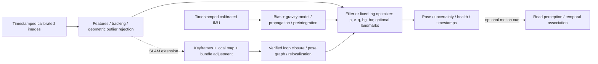

# VO, inertial odometry, VIO and SLAM

## One-page comparison and architecture

| Method | Inputs and estimated quantities | Scale and drift | Map / loop closure |
|---|---|---|---|
| Monocular VO | Matched/tracked image features; relative camera rotation and translation direction | Monocular scale is unknown; tracking errors accumulate | A local feature structure may support odometry; global loop correction is not implied |
| Inertial odometry | Gyro/accelerometer plus initial attitude, gravity and bias models; orientation, velocity and position | Physical sensor units do not prevent bias/gravity errors and rapid drift | No visual map or loop closure by itself |
| VIO | Camera constraints and inertial propagation; typically position, velocity, quaternion and gyro/accel biases | Metric scale can become observable with sufficient excitation/calibration; global position and yaw gauges remain | Local filtering or fixed-lag optimization; loop closure is a separate addition |
| SLAM | Observations and a consistent pose/landmark or dense-map representation | Map constraints and verified revisits can correct drift; failure/scale depend on sensors | Keyframes, local mapping/optimization, place recognition, pose graph and relocalization |



This is a conceptual full-system diagram. The local Python modules implement essential-matrix VO, gyro quaternion integration, an attitude-only complementary experiment and rotation-assisted box tracking. They do **not** implement this full VIO/SLAM optimizer, online bias estimation, global map or loop closure. Separately, the pinned external OpenVINS adapter runs an actual mono VIO dataset demonstration with position/velocity/attitude/bias states and visual updates. It is not an ORB-SLAM3 run or custom phone VIO integration. See [reproduction and measured limits](PERCEPTION-AND-ESTIMATION.md#independent-full-vio-demonstration).

## Mathematical intuition and implementation boundary

A representative VIO state is `x=[p_WB, v_WB, q_WB, b_g, b_a, landmarks(optional)]`. Gyro propagation changes attitude, while specific force must be rotated and gravity restored to predict acceleration:

```text
q_next = q * Exp((omega_measured - bg)*dt)
a_W = R_WB*(f_measured - ba) + g_W
v_next ≈ v + a_W*dt
p_next ≈ p + v*dt + 0.5*a_W*dt²
visual residual = observed pixel - project(K, camera pose, landmark)
```

These equations require compatible frames and times. An error in attitude rotates gravity into a false horizontal acceleration, and double integration then magnifies position drift. Correct gyro availability alone does not establish camera–IMU temporal or extrinsic calibration. The current orientation module integrates rotation only and never presents double-integrated position as reliable.

Image-only translation and scene depth can be rescaled together without changing projection. IMU acceleration can constrain metric scale when the motion excites the needed states and gravity/bias can be distinguished. Constant velocity, weak excitation, timing error, bias or wrong extrinsics can defeat that observability. A large neural depth value does not independently solve this calibration problem. The global origin and yaw remain gauge choices without additional absolute information.

An essential matrix encodes calibrated two-view epipolar geometry; a homography models a plane or pure rotation. The essential-matrix demo uses forward/backward LK filtering, RANSAC, positive-depth support and a rotation-compensated parallax check. Repetitive texture, planar scenes, blur, changing exposure and moving road users can still produce bad constraints. A moving car is not a stationary landmark; geometric rejection or explicit dynamic masks are needed, and a moving majority can fool RANSAC. The demo records failed intervals rather than inventing missing poses.

## Estimator and SLAM design study

In filter-based VIO (such as the MSCKF family), IMU propagation runs at high rate and visual constraints update a maintained state/covariance, often using cloned camera poses and eliminating temporary features. Fixed-lag optimization maintains recent poses/biases and minimizes visual/inertial residuals, marginalizing older variables to bound cost. A loosely coupled method consumes already-estimated visual motion/pose; a tightly coupled method jointly uses visual residuals and inertial dynamics. The local complementary attitude experiment is loosely coupled and has none of a full estimator's scale, position or online-bias guarantees.

Preintegration summarizes many IMU readings between keyframes into relative rotation/velocity/position constraints with noise and bias sensitivity, reducing repeated integration during optimization. It does not remove the need for calibration, uncertainty propagation or bias correction. See [Forster et al., on-manifold preintegration](https://arxiv.org/abs/1512.02363).

[VINS-Mono](https://arxiv.org/abs/1708.03852) is an example of a tightly coupled optimization approach with initialization, failure recovery and loop-related machinery. It should not be equated to simply averaging a gyro angle and a visual angle. [ORB-SLAM3](https://arxiv.org/abs/2007.11898) provides visual/visual-inertial SLAM and multi-map operation; installing a sensor client does not implement its front end or back end.

Feature-based methods match selected visual landmarks; direct methods minimize image-intensity residuals and depend strongly on photometric assumptions. Keyframes keep informative views, local bundle adjustment refines poses/landmarks, and global pose-graph optimization uses verified revisit constraints. Relocalization recovers a lost camera against a known map. A loop closure can reduce accumulated drift by connecting distant trajectory portions; ordinary local VIO need not recognize that revisit. False place recognition can corrupt the map, particularly on repetitive roads.

Low texture/night, motion blur, rolling shutter, weak parallax, dynamic vehicles, repetitive markings and wrong sensor time/extrinsics are separate failure mechanisms. More model confidence or a smoother plot does not repair these assumptions. Ground-truth alignment belongs in evaluation, not estimator feedback. The EuRoC report records its single fixed initial orientation alignment and leaves failed VO intervals in the result.

For the first road-perception prototype, calibrated motion cues and honest recorded evaluation can be useful before full SLAM. Full production metric VIO/SLAM remains outside the Month-1 requirement; its state, residuals, calibration constraints and limitations still need to be understood.
