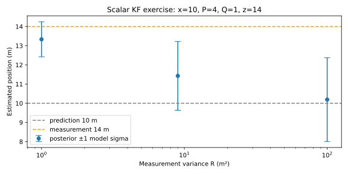
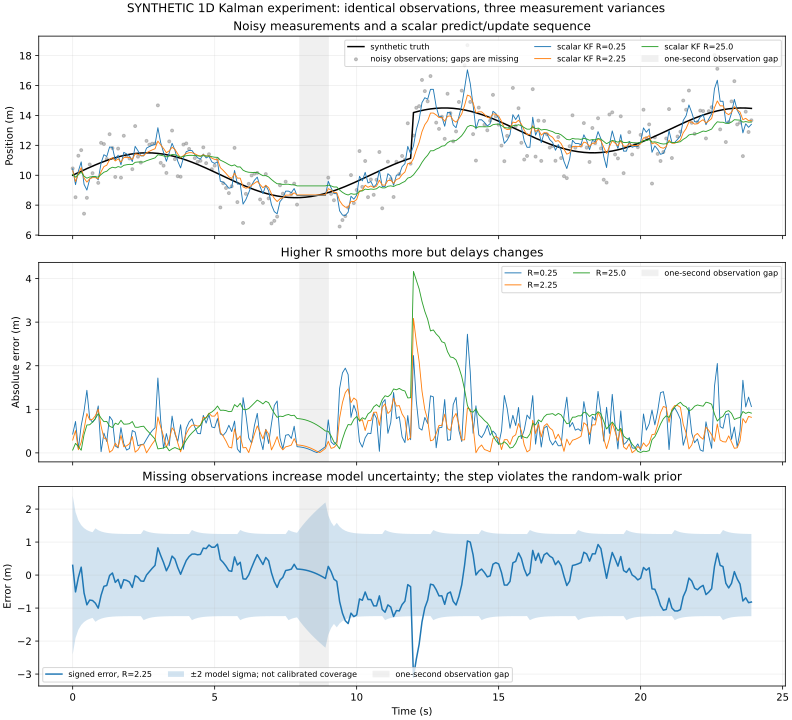
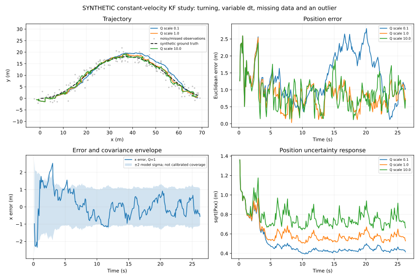
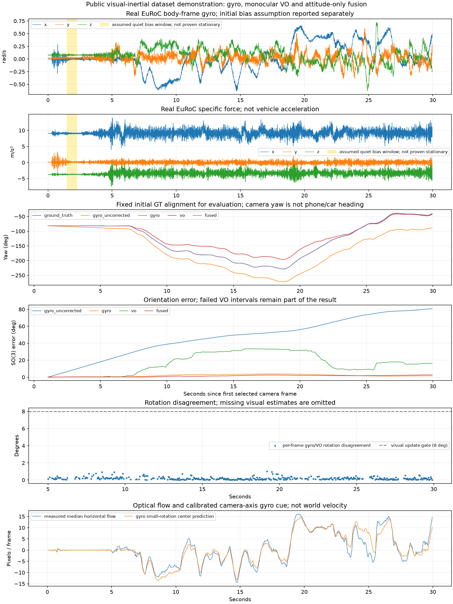
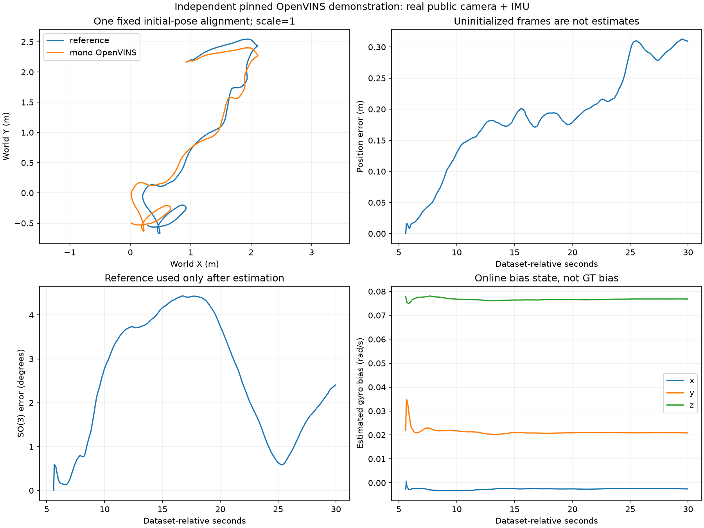
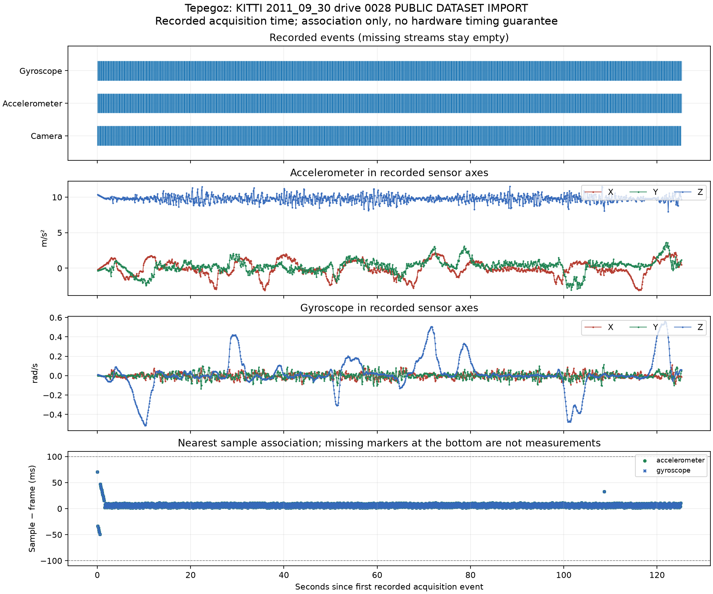

# Weeks 2–3: measured public-data results

Recorded **28 October 2026**, Asia/Baku. Public datasets were used because no finalized phone recording is available. This evidence covers PC processing and the learning experiments; physical Week 1 acceptance remains pending. Methods, exact contracts and commands are in [the implementation guide](../PERCEPTION-AND-ESTIMATION.md), with [upstream attribution](../THIRD-PARTY.md).

## Road perception and runtime

The serial benchmark uses three supplied Udacity clips, original indices 0,2,…,198 for 100-frame lane/object runs, and 0,10,…,110 for 12-frame depth comparisons. Both lane baselines run when lanes are enabled. Tiny detection uses score ≥0.25, class-aware NMS IoU 0.45, and the tracker starts new IDs at score ≥0.4. Depth uses dynamic ViT-S inputs with a 518-pixel long edge rounded to multiples of 14. These are selected subsets, not exhaustive road validation.

Hardware: Intel Core Ultra 7 258V, 8 logical CPUs, approximately 31.5 GiB physical memory; Windows, Python 3.14.6, OpenCV 5.0.0, ONNX Runtime 1.31.1, CPUExecutionProvider, four inference threads. GPU VRAM is unmeasured. One serial pass includes first-frame warm-up effects; local I/O, background work and thermal conditions can change timings. Model loading is excluded; decoding, inference, rendering, video/JPEG output and depth-map saving are included.

| Scene | Lanes FPS | Objects/tracks FPS | Combined, no depth FPS | Combined, both depths FPS |
|---|---:|---:|---:|---:|
| White right marking | 17.94 | 31.80 | 9.97 | 0.91 |
| Yellow left marking | 17.58 | 31.27 | 10.29 | 0.94 |
| Curved/shadowed challenge | 14.48 | 27.12 | 8.73 | 0.80 |

The [CSV](vision_benchmark.csv) and [JSON](vision_benchmark.json) contain all 15 runs, module mean/p95 times, model/code hashes, class counts and limitations. Depth is the dominant CPU cost. On the white clip, relative depth averaged 528.32 ms and outdoor metric depth 275.44 ms per processed frame; saving their raw maps added 46.96 and 82.20 ms. These are different model artifacts, not evidence that every metric method is faster than every relative method.

Both indexed lane outputs, detections, observed/predicted tracks, optional camera motion and depth are stored independently. Overlay MP4s are visual previews; JSONL timestamps remain authoritative. The offline CLI accepts finalized collector sessions and explicitly labeled public imports. The browser remains the acquisition/replay interface.

## Lane and tracker findings

| Scene | Classical corridor available | YOLOP corridor available | Observed IDs with prediction | Observed IDs without prediction |
|---|---:|---:|---:|---:|
| White | 13/100 | 100/100 | 11 | 15 |
| Yellow | 17/100 | 92/100 | 22 | 20 |
| Challenge | 5/100 | 29/100 | 6 | 9 |

Availability means the fitter's heuristic confidence reached 0.4. It does not measure lane accuracy: an incorrectly fitted corridor can still be confident. Track ID totals are fragmentation proxies without exhaustive identities; the yellow scene shows no improvement under this proxy. Never call these ground-truth ID-switch counts. Predicted boxes are visibly stale and do not receive new depth observations.

YOLOP is the more useful default lane candidate on these clips; the classical method remains an interpretable baseline with weak coverage. Neither handles every scene. Six independent public day/night/snow stills add qualitative failure review, stored in [scene metadata](scene-images.json) and [CSV](scene-images.csv). Stills do not establish nighttime temporal continuity or FPS under actual night capture.

## Detector choice and class-specific limits

The selected COCO evaluation has 15 images and 85 annotations across the six requested classes, retaining every target-class instance in each chosen image. Selection uses the first eligible sorted validation IDs per class and excludes target crowd images. It is nonrandom and small. The implemented protocol uses 101-point interpolated AP, IoU 0.50:0.05:0.95, up to 100 predictions/image, and a 0.05 inference cutoff. It is **not official full-COCO mAP**.

| Model | Subset mAP50 | Subset mAP50:95 | Detector FPS, excluding image I/O/model load |
|---|---:|---:|---:|
| YOLOX-Nano | 0.504 | 0.350 | 84.77 |
| YOLOX-Tiny | 0.591 | 0.404 | 42.98 |

Tiny is selected for the quality advantage in this subset, with a clear speed cost. Its precision/recall at score 0.25 and IoU 0.5 are:

| Class | Ground-truth objects | TP / FP / FN | Precision | Recall |
|---|---:|---|---:|---:|
| Person | 52 | 32 / 1 / 20 | 0.970 | 0.615 |
| Bicycle | 5 | 1 / 1 / 4 | 0.500 | 0.200 |
| Car | 16 | 10 / 4 / 6 | 0.714 | 0.625 |
| Motorcycle | 3 | 3 / 1 / 0 | 0.750 | 1.000 |
| Bus | 5 | 5 / 1 / 0 | 0.833 | 1.000 |
| Truck | 4 | 0 / 4 / 4 | 0.000 | 0.000 |

Truck/bicycle results are weak and class counts are too small to generalize. The [full subset report](detector-subset.json) records the actual model hashes and per-class AP. Detector-only FPS above cannot be substituted for combined throughput.

## Depth association and temporal behavior

Both depth candidates run on the same indexed RGB frames. Relative output is arbitrary inverse depth, larger nearer. Outdoor output is `model_m_unvalidated`, larger farther. Neither provides independently validated object distance on these clips. Colorbars, JSONL contracts and box labels retain those distinctions; the metric model is not treated as ground truth for the relative model.

Object association uses the median of the central 50% of an observed box, rejecting tiny/empty/off-image patches. P10/P90 indicate pixel spread only. A separate 30/50/100%-interior diagnostic used 56 boxes per model: mean absolute half-versus-full difference was 0.02598 relative units and 0.56590 model-meters. See [ROI sensitivity](depth_roi_sensitivity.json) and its [CSV](depth_roi_sensitivity.csv). This measures sensitivity to background inclusion, not depth accuracy or calibrated uncertainty.

On the depth subset, adjacent unregistered normalized-map changes were 0.00657/0.02183 (relative/metric) on white, 0.00597/0.02447 on yellow, and 0.01519/0.04374 on challenge. These mix actual motion, content changes and normalization with model variation; they are **not pure flicker error**. AbsRel/RMSE and calibrated meter accuracy are unavailable without matching independent depth truth. CPU throughput with both depth models is unsuitable for live-rate claims.

## Kalman and orientation exercises

The [deterministic lab](kalman-lab.json) implements the scalar example, variable-dt 2D constant-velocity filtering, noisy/missing/outlier observations, turning motion, Q/R sensitivity, innovation gating, Joseph covariance and a checked heading-model Jacobian. The plotted envelopes are model covariance, not an independent accuracy guarantee. The turning case deliberately violates constant velocity.

For x=10, P=4, Q=1 and z=14, R=9 gives K=5/14 and x=11.428571, P=3.214286. R=1 gives x=13.333333; R=100 gives x=10.190476. The yaw exercise gives 1.1 rad/63.0254° raw and 1.0 rad/57.2958° after subtracting 0.01 rad/s for 10 seconds. These are synthetic teaching exercises, not device measurements.

The separate 240-step scalar sequence includes noisy observations, 24 missing measurements, a one-second observation gap and an unmodeled position step. With Q=0.08 per step and R=2.25, filtered RMSE on observed timestamps is **0.658 m**, versus **1.391 m** for the same raw observations. Filtered all-time RMSE is 0.638 m. R=0.25 and R=25 give observed-time RMSE 0.801 m and 1.118 m: trusting noise too much or lagging real changes both have costs. The [CSV](scalar-timeseries.csv) preserves all observations/estimates/variances; synthetic results do not establish physical performance.

## Real EuRoC motion and first fusion experiments

The real `V1_01_easy` subset has 600 monochrome camera frames and 5,993 IMU samples over approximately 30 seconds, with supplied intrinsics and camera/IMU extrinsics. An offline quiet-window search selected 1.50–2.245 seconds to estimate gyro bias under a stationary assumption; no ground-truth bias is fed back. Low variance cannot prove stationarity. Each estimator receives one fixed initial ground-truth orientation alignment for evaluation; no subsequent pose feedback is used.

| Orientation estimate | Mean SO(3) error | Maximum error |
|---|---:|---:|
| Raw gyro | 47.576° | 80.897° |
| Quiet-window bias-corrected gyro | 1.950° | 3.732° |
| Accumulated essential VO, including failed intervals | 16.720° | 33.579° |
| Attitude-only complementary experiment | 1.376° | 2.698° |

The essential-matrix front end accepted 386/600 frames. Initialization, low parallax, cheirality, rotation-only and homography-dominant intervals remain recorded. Monocular translation is unscaled and skipped intervals break accumulated VO continuity. The complementary result is an attitude experiment, **not a full position/velocity/bias VIO or SLAM estimator**. Short-subset gains do not establish general performance. Full [motion statistics](euroc-motion.json) include every failure reason.

The median horizontal-flow versus calibrated gyro small-rotation cue has Pearson r=0.952 over 599 pairs. It is image motion, not vehicle heading or object velocity. Translation and off-axis bearings also affect flow.

A separate real-IMU feature-tracking comparison used identical corners across 149 pairs at camera stride 4:

| Variant | Forward/backward consistent features | Median pair GT Sampson residual |
|---|---:|---:|
| RGB only | 62.04% | 0.482 px |
| Gyro seeded | 64.57% | 0.453 px |
| Wrong gyro sign | 45.82% | 0.490 px |

Ground truth only evaluates epipolar residuals. Forward/backward consistency is not exact landmark identity. See [the feature ablation](gyro-flow-ablation.json).

The separate 60-frame **synthetic pure-rotation** road-box stress test used a real public still and four approximate reference boxes. RGB-only/correct-rotation/wrong-sign variants had 184/0/129 reference-subset ID switches, but 28/60/84 missing reference observations. Correct compensation kept identities while losing observations: this is a tradeoff, not an unconditional improvement. Known pure rotation favors the model; translation, dynamic objects, calibration error and real phone timing were absent. See [the controlled ablation](controlled-rotation-ablation.json).

## Independent OpenVINS VIO demonstration

Pinned upstream commit `69488123ed9362dd44b6f28e7f4680abbff1442b` ran separately in a local Linux Docker container using the selected raw EuRoC camera/IMU inputs. The adapter uses mono mode and fixed supplied camera calibration; OpenVINS estimates position, velocity, attitude and sensor bias with visual constraints. The C++ runner has no ground-truth input. This is an actual upstream VIO run, distinct from our Python attitude-only fusion.

It emitted **488 initialized poses** from 5.60 to 29.95 seconds, leaving the first 5.6 seconds visibly uninitialized. Subsequent evaluation used one fixed first-matched-pose SE(3) alignment with **scale 1**, not a trajectory-wide fit. Nearest reference matching had maximum 0.000256 ms difference. Position RMSE was **0.2035 m**, final error **0.3091 m**, and mean SO(3) orientation error **2.540°**. See [the full report, image ID and adapter hashes](openvins-euroc.json). No GT state/bias initialization or estimator feedback was used.

The plot demonstrates a short public VIO run with drift and delayed initialization. It does not validate phone VIO, full-sequence performance or global loop closure/relocalization. The earlier attitude table uses a different initialization/evaluation interval and should not be treated as a matched ranking against this VIO result. Docker startup/decode/mounted-file timing also differs from the Windows ONNX benchmark.

## Real color-road camera/IMU replay and integration

The KITTI import contains **1,205 actual color frames over 125.09 seconds** and 1,206 synchronized OXTS packets. Native sensor axes, original calendar timestamp text and measured camera calibration are retained; one common integer time origin is subtracted without asserting a source timezone. Already rectified PNGs become explicitly derived JPEGs. OXTS observed cadence is about 9.63 Hz, not high-rate phone IMU.

Analysis found no sequence gaps, duplicate IDs, missing JPEGs or orphan files. All frames have accelerometer/gyro matches within the analysis ±100 ms window; p95 mismatch is 10.794 ms and maximum is 70.559 ms. These are association differences, not physical timing accuracy. The gyro-tracking adapter uses a stricter declared 50 ms match tolerance and ≤0.25 s integration gaps for this dataset, with zero bias assumed. See [alignment diagnostics](kitti-alignment.json). Two replay runs in the same folder emitted identical 1,205-line bytes, recorded in [replay verification](kitti-replay.json).

The actual real-road ablation compares **identical indexed detector outputs** across both variants. Gyro assistance is used on 1,203 frames; one unmatched frame and the first aligned initialization frame remain disabled explicitly.

| Fragmentation proxy | RGB only | Real gyro rotation |
|---|---:|---:|
| Observed IDs | 320 | 230 |
| Tracks with ≤2 observations | 132 | 78 |
| Predicted/stale track records | 2,223 | 1,675 |

These proxies suggest less fragmentation, but without exhaustive semantic identities they cannot prove fewer incorrect identity assignments. Both variants use the same detections and timestamp base. Pure rotation still ignores translation, independent object motion and rolling shutter. See [the complete matched-input report](kitti-tracking-ablation.json). These functional runs overlapped other processes; their wall FPS is not a controlled speed comparison.

The integrated run processed 100 original-index frames at stride 2 with classical/YOLOP lanes, Tiny detection/tracking, both depth models and real gyro assistance. Independent logs and raw maps preserve timestamps and units; the [integrated summary](kitti-integrated.json) retains settings and hashes. Local output: `.tools/experiments/kitti-integrated/overlay.mp4`, with preview frames 0,50,100,150. The residential street has weak/unmarked lanes; unavailable corridor confidence stays zero even while object/depth outputs continue. This proves the public-data path through the stack, not phone acquisition or validated distance.

## Failure gallery and acceptance boundaries

Local images are generated by the reproduction commands and remain under `.tools/experiments/`; this report does not redistribute the day/night/snow photographs.

| Evidence | What was visibly observed | Implication |
|---|---|---|
| `scene-images/7dd9ef45-f197db95-comparison.jpg` | Snow obscures markings; both corridors unavailable; the vehicle hood is detected as a large car at about 0.40 confidence | Segmentation and detector domain failures can occur together |
| `scene-images/3c0e7240-96e390d2-comparison.jpg` | Night lane pair crosses and is rejected; nested/duplicate car boxes remain on a parked vehicle | Heuristic lane rejection is useful; NMS does not remove every duplicate |
| `weeks2-3-release/challenge-combined/previews/00000180.jpg` | YOLOP lane pair is rejected on the curve; classical confidence alone cannot verify the fitted curve | Availability must not become an accuracy claim |
| White-road first frame | Tiny horizon vehicles are missed while nearer cars are detected | Detector class support does not imply reliable distant-object recall |
| Yellow prediction ablation | 22 observed IDs with prediction versus 20 without | Constant velocity does not always help association |
| Controlled correct-rotation ablation | Stable IDs but more missing reference observations | Report coverage alongside identity continuity |

The [frame/timing guide](../FRAMES-AND-TIMING.md) and [VO/VIO/SLAM study](../VO-VIO-SLAM.md) cover frames, gravity, scale, bias, Jacobians, preintegration, gauges, mapping and loop closure. Remaining phone tasks are sensor availability/rates, USB/tunnel stress tests, true display-latency measurement, camera/mount calibration and a compliant two-minute physical recording. Public data cannot pass those gates. Week 4's live demo, final report/video and technical defense remain separate deliverables.

The [checkerboard workflow](../CALIBRATION.md) now supplies practical intrinsics/distortion fitting, held-out pose-fit errors and an undistortion preview. Its public OpenCV example has 0.2531 px training RMS and 0.3395/0.2408 px held-out RMS. It prepares the calibration work without substituting public-camera parameters for the phone or inventing a mount transform.
